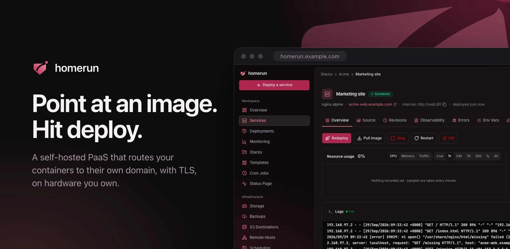

# Homerun

**A self-hosted PaaS that starts on one box. Swarm workers when you want more.
No Kubernetes, no separate control plane.** Deploy Docker containers with a
click-config form, a Dokploy / Cloud Run alternative for your own hardware, for
you alone or a whole team. MIT licensed.

Point at an image (or a git repo), fill in env vars / port / resources, hit
deploy: Traefik routes it to `<slug>.yourdomain.com` with TLS, automatically.
Then drive the same instance from a REST API, a CLI, an MCP agent, GitHub
Actions, a manifest in your repo or Terraform, whichever fits.

> **Status:** Actively developed, running on real hardware, but still finding
> its shape: see [`docs/faq-and-limitations.md`](docs/faq-and-limitations.md)
> for what's solid and what isn't yet.

<!-- Regenerate with `bun scripts/feature-graphic.ts`; do not edit by hand. -->

**[See the full showcase →](docs/showcase.md)**: every screen, light and dark,
generated from a real instance.

## Why Homerun

Dokploy, Coolify, and friends are great, but a few things I can't get around:

- Coolify has many bugs and a lot of tech debt
- Dokploy has started paywalling features that homelab enthusiasts could use,
  for the benefit of enterprise.

Homerun keeps everything in the open, MIT licensed: multi-node swarm, teams and
roles, previews, IaC and the API are all just features, not a paid tier.

## Features

### Deploying

- **[Image or git repo](docs/deploy-source-and-builds.md#deploy-source-image-or-git-repo)**:
  deploy any Docker image (private registry auth included), or clone a repo by
  branch, tag or pinned commit and build it on the host, with no registry in
  between
- **[Six build methods](docs/deploy-source-and-builds.md#build-methods)**: a
  `Dockerfile` or a Docker Bake target built with BuildKit (cache mounts,
  multi-stage, `# syntax=`), or no Dockerfile at all with Nixpacks, Railpack,
  Heroku or Paketo buildpacks, builder binaries checksum-verified
- **[Deploy on push](docs/deploy-on-push.md)**: Homerun registers the webhook on
  your repo for you, and falls back to polling the branch when the git provider
  can't reach your dashboard (LAN, VPN)
- **[Pull request previews](docs/pull-request-previews.md)**: every pull request
  gets its own `<slug>-pr-<n>` service, redeployed on each push and deleted on
  merge or close, with forks never previewed
- **[Required status checks](docs/status-checks.md)**: a git service waits for
  the CI checks you pick to pass, then builds exactly the commit they passed on
- **[Build servers & build cache](docs/deploy-source-and-builds.md#build-servers-and-build-cache)**:
  compile on another Docker daemon (`tcp://`, `ssh://` or the lightweight
  [Homerun Agent](docs/remote-hosts-and-agent.md#homerun-agent)), and share
  BuildKit layer cache through a registry
- **[Live deploy progress](docs/deploying.md)**: pull/build/create/start
  streamed to the UI in real time, and it resumes if you reload mid-deploy or
  the deploy started somewhere else
- **[Zero-downtime, health-gated redeploys](docs/deploying.md)**: the new
  container starts next to the old one and only gets traffic once it's ready
  (its healthcheck, the image's, or a port check Homerun adds itself); a new
  copy that never comes up is removed and the old one keeps serving
- **[Revisions & rollback](docs/revisions-and-rollback.md)**: every deploy
  recorded with its image digest, commit and full log; redeploy any earlier
  revision's exact image, with opt-in auto-rollback when a new one turns
  unhealthy
- **[Image scanning](docs/image-scanning.md)**: every deploy scanned with Trivy
  through a local registry mirror before it starts, so the container runs
  exactly what was scanned, with an admin policy that blocks deploys at or above
  a chosen severity (optionally fixable findings only)
- **[Environments](docs/environments.md)**: copies of a service running another
  branch or tag (`staging`, `qa`), each one a real service of its own with its
  own hostname, listed with its previews and canary on one tab
- **[Release channels](docs/release-channels.md)**: "a branch is canary, a tag
  is stable" in one switch, a managed `<slug>-canary` service deployed on every
  push and the service itself on every matching tag
- **[Version pinning & update checks](docs/deploy-source-and-builds.md#version-pinning-and-update-checks)**:
  swap `:latest` for the exact tag that's running, watch the registry for a
  newer release on the same track, trial-run it before you're notified, and
  update in one click
- **[Homerun Manifest](docs/manifest.md)**: keep a service's whole config in a
  `.homerun.json` / `.homerun.yaml` in the repo, applied before every build, or
  push it at any service from the CLI or API
- **[Compose import](docs/compose-import.md)**: paste a `docker-compose.yaml`
  and get its services, volumes, runtime options and dependency order as Homerun
  services, with a preview of anything that doesn't map across
- **[Migrate from Dokploy or Coolify](docs/migrating-from-dokploy-or-coolify.md)**:
  read another instance's apps, compose stacks and databases (read-only on their
  side) and recreate them here, builders and start commands included

### Running services

- **[Multi-node with Swarm](docs/swarm-mode.md)**: the installer's default,
  every service is a Docker Swarm service with replica scaling and load
  balancing across nodes, and
  [another machine joins as a worker with one command](docs/remote-hosts-and-agent.md#adding-a-server-with-one-command);
  standalone (one container per service) stays available for a single box
- **[Remote hosts](docs/remote-hosts-and-agent.md)**: register other Docker
  daemons over `tcp://`, `ssh://` (nothing to install but sshd) or the Homerun
  Agent to build images, run workstations or run cron jobs on
- **[Env vars & env files](docs/env-vars.md)**: key/value rows plus `.env` files
  read off the host at each deploy, with a per-variable secret lock always
  redacted for AI agents regardless of name
- **[Smart service links](docs/env-vars.md)**: point a service at an existing
  Postgres, MySQL, Redis, Mongo, RabbitMQ or HTTP service and get the connection
  URL, JDBC URL or one variable per value filled in for you, unlink it later
  with one click
- **[Runtime options](docs/runtime-and-compute.md#runtime)**: entrypoint,
  command, custom labels, and (System permission) added capabilities, device
  mappings and privileged mode
- **[Compute & settings](docs/services.md#settings)**: CPU/memory limits,
  replicas, restart and pull policies, a healthcheck command, and scanning and
  auto-rollback per service
- **[Live logs](docs/observability.md#logs) &
  [a web terminal](docs/observability.md#terminal)**: tail stdout/stderr or open
  an interactive shell into a running container from the browser, or
  [on the machines themselves](docs/machine-terminals.md) over SSH
- **[The services list](docs/services.md#the-services-list)**: server-side
  search, filters and paging on every list page, a list/card toggle, a
  dependency-tree view across every service, and bulk Start/Stop/Restart/Delete
  with a typed confirmation before anything destructive

### Stacks & templates

- **[Stacks](docs/stacks.md)**: group services on their own private Docker
  network so they reach each other by slug (`http://api:8080`), with prefixed
  subdomains, nested substacks, a dependency tree/diagram of a stack's services,
  and one-step delete of the whole stack
- **[~110 built-in templates](docs/templates.md)**: Immich, Jellyfin, Plex, the
  \*arr stack, Pi-hole, Vaultwarden, Grafana, Uptime Kuma, PostgreSQL, Redis,
  n8n and more, with real app logos, one-click **Quick Deploy**, and a details
  page that pulls in the project's GitHub README, stars and latest release
- **[Linked containers](docs/templates.md#linked-containers)**: companions
  deploy with the primary (WordPress brings MySQL), and env vars like
  `{{db.POSTGRES_PASSWORD}}` wire them together without retyping
- **Custom templates**: save any service's config as your own template, or build
  one from scratch

### Workstations & terminals

- **[Machine terminals](docs/machine-terminals.md)**: a shell on this server and
  every remote host, in the browser, over SSH from Homerun's worker, so a
  machine only needs an SSH server and Homerun's public key
- **[Browser-based dev boxes](docs/workstations.md)**: a code-server or
  openvscode-server container with a persistent home volume, your repo already
  cloned and its dev container config applied, on this server or any remote
  host, behind the login wall, with auto-stop and presets for the setups you
  reuse; personal to each account

### Networking & domains

- **Automatic routing & TLS**: Traefik routes every service to
  `<slug>.<baseDomain>` with a certificate, with no host ports published
- **[Domains & SSL](docs/networking.md#domains--ssl)**: any number of extra
  hostnames per service, each with its own router, plus bring-your-own cert/key
  for domains outside Traefik's automatic ACME coverage
- **[Path-based routing](docs/networking.md)**: route `example.com/api` to one
  service and `example.com` to another on the same origin, with optional prefix
  stripping and a login wall scoped to the path
- **Hostname ownership**: every domain belongs to exactly one service,
  workstation, redirect or the dashboard itself, conflicts are refused with the
  owner named, and a domain can be taken over on purpose
- **[Redirects](docs/redirects.md)**: send a hostname or a path to another URL,
  answered by Traefik with no container
- **[Blocked paths & IP bans](docs/blocked-paths-and-ip-bans.md)**: turn away
  the `.env` / `.git` / `wp-login.php` scanners before they reach the app, ban
  repeat offenders, and push bans to CrowdSec
- **[Branded error pages](docs/error-pages.md)**: replace Traefik's bare `404`
  and `Bad Gateway` with a page that says what's going on
- **[Host networking](docs/networking.md)**: for apps that need the host's
  network directly (mDNS/SSDP discovery)
- **[DNS automation](docs/dns-automation.md)**: your domains' records at 16 DNS
  providers (Cloudflare, Route 53, Google Cloud DNS, Azure, Hetzner, Namecheap,
  GoDaddy, OVH…), managed from the dashboard and created and removed as services
  come and go, or Pangolin resources, and Homerun can run the Pangolin Newt
  tunnel client for you, set up straight from onboarding
- **[Per-app login wall](docs/login-wall.md)**: put any deployed service behind
  a Homerun login (passkeys and 2FA included) through Traefik forwardAuth

### Storage & backups

- **[Storage volumes](docs/storage-volumes.md)**: bind mounts or Docker-managed
  volumes defined once, mounted into one or more services, read-write or
  read-only, with a database or cache getting one at its data directory
  automatically
- **[Volume backups](docs/backups.md#backups)**: scheduled or on-demand backups
  of both volume kinds to any S3-compatible bucket, or over SFTP, SMB or WebDAV
  (a Hetzner Storage Box, a NAS), with optional service stop or a pre-backup
  command (`pg_dump`, `mysqldump`) for consistent database copies
- **[Restore from the dashboard](docs/backups.md#restoring-a-backup)**: browse a
  volume's backups at its destination and restore one, optionally wiping the
  volume first, with a searchable history of every run

- **[Object storage](docs/object-storage.md)**: a built-in S3 store Homerun runs
  for you, plus any S3-compatible provider you connect, with buckets, expiry and
  public buckets managed from one page

### Observability & notifications

- **[Monitoring](docs/observability.md#monitoring)**: requests, average response
  time, error rate, bandwidth, uptime and CPU and memory per service, from today
  to all time, recorded from Traefik's metrics every minute

- **[Uptime probes](docs/observability.md#uptime)**: every service probed every
  minute from the Docker network and from its public hostname, with failure
  reasons and fix hints
- **[Status pages](docs/status-pages.md)**: private or public uptime pages for
  every service, one stack, or services you pick
- **[Resource history](docs/dashboard.md)**: live and historical CPU, memory,
  disk, network and NVIDIA GPU usage for the host and each service, kept for a
  year, plus top consumers per instance and per stack
- **[Errors in context](docs/observability.md#errors)**: failed deploys and the
  warnings Homerun logged about a service, on that service's page, with crash
  and "container is gone" banners
- **[Error tracking](docs/error-tracking.md)**: Sentry-protocol compatible, so
  the official Sentry SDKs report straight to Homerun, grouped into issues with
  stack traces linked back to your source and source maps applied
- **[Tracing](docs/tracing.md)**: a built-in OpenTelemetry collector and a
  waterfall view of every span, including Homerun's own background jobs
- **[Notifications](docs/notifications.md)**: an in-app bell, plus Discord,
  Slack, Telegram, webhook and email channels subscribed to build, deploy,
  update, rollback, scan and up/down events, retried when delivery fails

### Scheduling

- **[Scheduled redeploys](docs/scheduling.md#scheduled-redeploy)**: cron-style
  auto-redeploy per service to pick up new images
- **[Cron jobs](docs/scheduling.md#cron-jobs)**: a throwaway container, a script
  on a Bun, Node, Deno, Python or `sh` runtime, or a host command (needs the
  System permission), on a schedule or on demand, with secret env vars, config
  files, volumes, exit codes, output and traces kept per run, and
  [on another host over `tcp://` or `ssh://`](docs/scheduling.md#running-on-another-host)
- **[The Scheduling page](docs/scheduling.md#the-scheduling-page)**: every cron
  redeploy, job and backup schedule, plus the live job queue, on one page

### Users & security

- **[Multi-user, with roles & invites](docs/users-and-roles.md)**: five roles
  (admin, developer, read-only, app access only and custom, where you pick the
  areas), email or direct-create invites, and a resource pool the whole team
  shares; an app access only account never sees the dashboard, it only gets
  through the login walls of the apps you choose
- **[Service accounts](docs/users-and-roles.md#service-accounts)**: non-human
  accounts for CI and scripts, with no sign-in method, API keys as their only
  credential, permissions capped at yours and every use logged on an Activity
  tab; they can also get CI through an app's login wall
- **[OAuth/OIDC sign-in](docs/authentication-providers.md#oauth--oidc-login)**:
  one-click presets for Pocket ID, Keycloak, Authelia, Authentik, Logto, Zitadel
  and Kanidm
- **[Passkeys & two-factor](docs/two-factor-and-passkeys.md)**: which an admin
  can require for every account
- **[Sign in with Homerun](docs/sign-in-with-homerun.md)**: Homerun is an OpenID
  Connect provider too, so the apps you host (Grafana, Gitea, Outline, Immich…)
  log in with your Homerun accounts, passkeys and 2FA rules
- **[Git provider accounts](docs/git-providers.md)**: connect GitHub, GitLab,
  self-hosted Gitea or Bitbucket and pick a repo and branch instead of pasting
  URLs
- **[API keys](docs/your-profile.md#api-keys)**: per-area permissions and an
  expiry, created by hand or through `homerun login`
- **Hands off everything else**: every container is labeled
  `homerun.managed=true`, and Homerun never touches anything it didn't create
  (Docker Cleanup being the one deliberate exception)

### Automation: API, CLI, IaC & CI

Everything you can click, you can script.

- **[REST API & OpenAPI](docs/api-and-cli.md)**: everything in the dashboard is
  also a typed JSON API (`/api/v1`), authenticated by session or API key, with a
  live Swagger UI
- **[The `homerun` CLI](cmd/cli/README.md)**: a small (~6MB) standalone Go
  binary covering services, stacks, previews, workstations, version pins, the
  registry and more; logs in through a device-code flow and updates itself
- **[Infrastructure as code](docs/infrastructure-as-code.md)**: a Terraform /
  OpenTofu provider and Pulumi for stacks, services, every setting and the
  objects around them, with state kept in your own object storage, a starter
  config generated from what's already running, and drift detection
- **[Deploying from CI](docs/ci-cd.md)**: when your pipeline builds the image,
  it tells Homerun to deploy (optionally switching to the tag it just pushed)
  and waits for the deploy, so a failed deploy fails the pipeline
- **[GitHub Actions](docs/ci-cd.md#github-actions)**: `deploy`, `rollback` and
  `preview` actions that deploy the image CI just pushed and wait for it, so a
  broken deploy fails the pipeline, plus `gate-session` to run E2E tests behind
  a login wall; a
  [Docker image](docs/ci-cd.md#gitlab-ci-and-other-cis-the-docker-image) does
  the same for GitLab and every other CI
- **[Preview testing recipes](docs/github-actions-preview-testing.md)**: E2E
  against every pull request's preview, then ship the exact image that passed;
  or [main is canary, tags are stable](docs/main-canary-tags-stable.md)
- **[MCP server](docs/mcp.md)**: let Claude or any MCP agent diagnose and fix
  your services, with credential-shaped values redacted; an agent that supports
  Client ID Metadata Documents only needs the URL, others sign in through a
  client you register on the IDP page, and Claude Code uses an API key

### Install & operations

- **[One-line installer](docs/getting-started.md#option-a-the-one-liner-fresh-linux-server)**:
  Docker, a swarm manager, Traefik, Postgres and Homerun on a fresh Linux box in
  one command, or rootless Docker if you'd rather, and
  [a rootless-to-rootful migration](docs/getting-started.md#moving-a-rootless-install-to-rootful--swarm)
  for older installs
- **[First-run wizard](docs/configuration.md#the-first-run-wizard)**: configure
  base domain, email, sign-in and DNS in the dashboard, with no config file to
  maintain, and an
  [optional `homerun.yaml`](docs/configuration.md#the-optional-yaml-file) if you
  want config as code
- **[One-click self-update](docs/upgrading.md)**: from the sidebar, on the
  stable, canary or nightly release channel; the new version boots next to the
  running one as a candidate first and only takes over once it answers its
  readiness check, and a switch that doesn't come up rolls back to the version
  you had
- **[Setup diagnostics](docs/dashboard.md#setup-diagnostics)**: a banner that
  deep-links to the exact setting that's wrong
- **[System logs](docs/system-logs.md)**: live logs of Traefik, Postgres and
  Homerun itself, with Traefik restart and update buttons
- **[Docker Cleanup](docs/docker-cleanup.md)**: needs the System permission
  `docker system df`/prune from the dashboard with a preview before anything
  goes, plus automatic garbage collection of the scan mirror
- **[Docker Registry](docs/registry.md)**: turn the internal image mirror into a
  real private registry, `docker push` included, with push/pull tokens and an
  optional public hostname through Traefik
- **[Simple & advanced modes](docs/ui-modes.md)**: a short click-ops sidebar for
  the homelab, or the full engineering surface; switching only changes what's in
  view
- **[`⌘K` search](docs/dashboard.md#search)**: jump to any page, or to anything
  on the instance, from anywhere
- **[Appearance](docs/your-profile.md#appearance)**: light/dark/system theme,
  and a color palette or a custom accent color per account

## Configuration

You configure Homerun from its own dashboard. The installer sets up everything
the container needs to boot and then hands you a first-run wizard; after that,
base domain, Docker, Traefik, email, sign-in methods, DNS automation and
orchestration mode are all settings pages. There's no config file to maintain,
just `AUTH_SECRET` and `ORIGIN` if you're running `docker compose` by hand
instead of using the installer. An optional `homerun.yaml` file mirrors every
setting for config-as-code setups, with a dashboard change always winning over
the file. See [`docs/configuration.md`](docs/configuration.md).

## Documentation

[`docs/`](docs/README.md) in this repo is the source of truth, plain Markdown,
readable straight from the file browser. Start with
[Getting started](docs/getting-started.md). The
[website](https://homerun.orochibraru.com) renders the same files.

## Sub-projects

Three standalone tools live under `cmd/` alongside the main app, each compiling
to its own binary. All three are Go packages sharing one `go.mod` at the repo
root, not part of the SvelteKit build:

- [`cmd/worker/`](cmd/worker/README.md): the Go worker that runs Homerun's
  Docker access and background jobs next to the app; run standalone with no
  `DATABASE_URL`, the same binary becomes a small token-authenticated HTTP
  server that lets a second machine build images for this one, without exposing
  its Docker daemon (agent mode)
- [`cmd/installer/`](cmd/installer/README.md): the one-liner installer used
  above (Docker as a swarm manager, or rootless, plus the agent or full stack,
  and `--migrate-to-rootful` for older rootless installs)
- [`cmd/cli/`](cmd/cli/README.md): a CLI (`homerun services deploy <id>`, etc.)
  against the REST API

Plus the [Terraform provider](terraform/provider) under `terraform/` and the
GitHub Actions under [`actions/`](actions).

## License

MIT, see [`LICENSE`](LICENSE).
