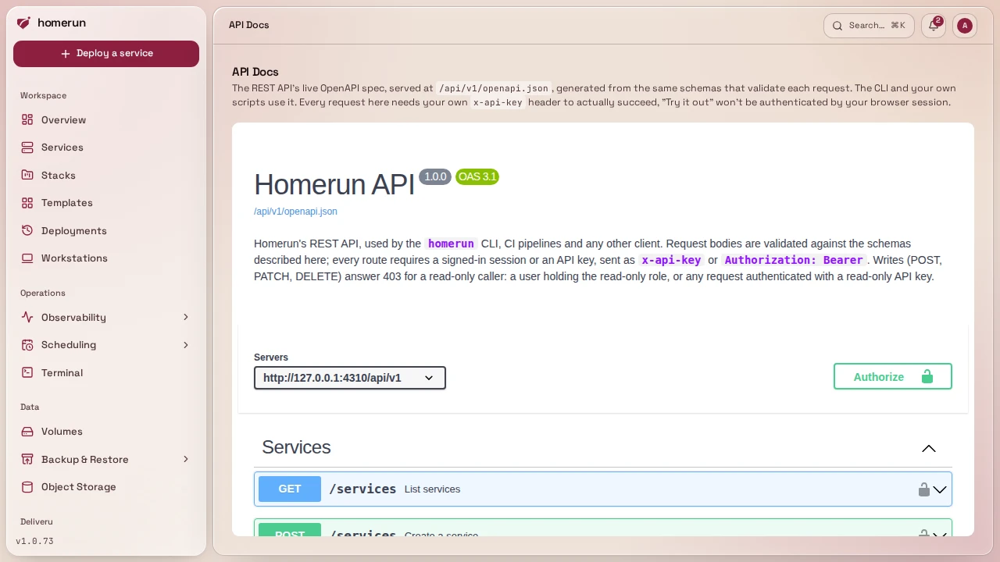
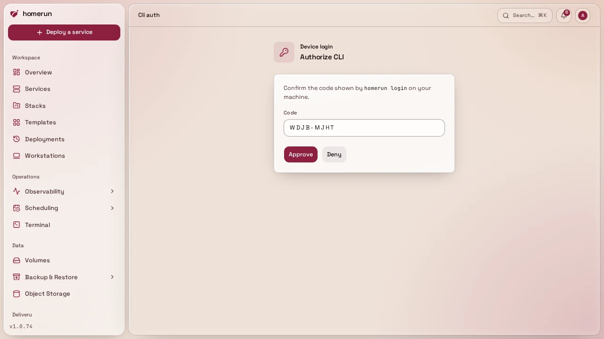

# API & CLI

## REST API

`/api/v1/*` is a thin, typed JSON wrapper over the same DTO layer the dashboard
itself is built on: not a separate abstraction. Every route checks its own auth
independently (a cookie session, or `x-api-key`/`Authorization: Bearer <key>`
from your profile page), so the same handlers serve the dashboard's own requests
and external API-key clients alike.

Every route belongs to one [permission area](users-and-roles.md#permissions)
(services, stacks, DNS and so on): a `GET` needs read access to it, a `POST`,
`PATCH` or `DELETE` needs write access. A request from an account or API key
without it answers `403` with an error naming the area, such as
`{"error": "You don't have permission to change Services."}`. An API key is
created with the permissions you pick, an expiry and, optionally, "all
permissions" (see [API keys](your-profile.md#api-keys)), and is always limited
to what its owner holds at that moment. A banned account's keys are refused with
a `403` until the ban is lifted or runs out. Profile, CLI login, the API docs
and the MCP endpoint are open to any signed-in account. An API key makes up to
3000 requests a minute; past that it gets `429 Too Many Requests` with a
`Retry-After` header (in seconds) until the minute is up. The OpenAPI spec lists
that `403` on every route.

The Terraform state routes under `/api/v1/iac/projects/:id/` (`state` and
`lock`, see [Terraform state](infrastructure-as-code.md#terraform-state)) also
take the key as an HTTP Basic password, with any username, since that's the only
credential Terraform's `http` backend sends. They need write access to
Infrastructure as code (and read for `GET`).

- `GET/POST /api/v1/services`, `GET/PATCH/DELETE /api/v1/services/:id`: a create
  or update adding a domain something else already routes answers `409` with
  `conflicts`, each `{domain, owner, ownerKind, ownerId, canTakeOver}`, and
  takes `"takeOverDomains": true` to move them from another service or a
  redirect (see [Domains](networking.md)); delete answers `409` while a job is
  queued or running for the service, and takes `?force=true` to cancel those
  jobs and drop Homerun's record even when the container or swarm service
  couldn't be removed, the API equivalent of the Settings tab's
  [**Force delete**](services.md#the-services-list) and **Delete anyway**
- `POST /api/v1/services/:id/{deploy,start,stop,restart}`: `deploy` awaits the
  full pull-or-build → create → start pipeline and returns once it's done (no
  separate polling endpoint for API clients: that's dashboard-only, for its own
  progress UI); with [release channels](release-channels.md) on,
  `{"environment": "canary"}` deploys the canary instead (`stable`, the default,
  deploys the service itself)
- `GET/PATCH /api/v1/services/:id/channels`: a git service's
  [release channels](release-channels.md), the canary branch, tag pattern,
  canary domain and canary service; `PATCH` takes `enabled` plus any of
  `branch`, `tagPattern` and `canaryDomain` (null clears it), and turning them
  off deletes the canary
- `GET/PUT /api/v1/services/:id/dependencies`: what a service depends on and
  what depends on it, each with its `id`, `name`, `slug` and `source`:
  `recorded` (a stored dependency, the only kind that sets
  [start order](env-vars.md)), `env` (an env value points at the other's slug as
  a host) or `both`. `PUT {"dependsOn": [ids]}` replaces the recorded ones (an
  empty list clears them) and leaves env vars alone; an unknown id, the service
  itself or one that already depends on it is a `400`
- `GET /api/v1/services/:id/logs`: the service's container or swarm service logs
  as plain text, the last `?tail=` lines (default 200, max 10000), or a live
  stream with `?follow=true`; a `400` for a service that was never deployed
- `GET /api/v1/services/:id/webhook`: the [push-to-deploy](deploy-on-push.md)
  payload URL and secret for that service, whether the branch is polled instead
  and which provider to reconnect when it refused the webhook, a 404 when none
  of Deploy on push, pull request previews or release channels are on
- `DELETE /api/v1/auth-token`: revokes the API key that authenticated the
  request, what `homerun logout` calls (see [Logging in](#logging-in) below)
- `GET/POST /api/v1/stacks`, `GET/PATCH/DELETE /api/v1/stacks/:id` (delete
  removes the stack's services too, `?force=true` like a service's),
  `GET /api/v1/templates`, `GET /api/v1/templates/:id`
- `GET/POST /api/v1/services/:id/scans`,
  `GET /api/v1/services/:id/scans/latest`,
  `GET /api/v1/services/:id/scans/:scanId`: image scan results, see
  [Image scans](#image-scans) below
- `GET /api/v1/services/:id/revisions`,
  `POST /api/v1/services/:id/revisions/:revisionId/deploy`: revisions and
  rollback, see [Revisions](#revisions) below
- `GET /api/v1/services/:id/deployments?limit=10`: the latest deploy attempts,
  failed ones included, each with its error and progress log (up to 50); these
  and revisions carry the `environment` they deployed (`production`, `canary`,
  `preview`, or the service's own `environmentName`, see
  [Release channels](release-channels.md#environments-in-the-history)), and each
  deploy attempt its `trigger` (`manual`, `cron`, `push`, `promote`, `rollback`,
  or null for a deploy from before triggers were recorded)
- `GET/PATCH /api/v1/services/:id/version`: an image service's
  [version pin and update checks](deploy-source-and-builds.md#version-pinning-and-update-checks),
  flat: `tag`, `pinnedFromTag`, `pinnedLocally`, the watch settings
  (`updateCheckEnabled`, `updateTrialEnabled` and `updateScope`: `major`,
  `minor` or `patch`, which `PATCH` takes) and what the last check found
  (`availableTag`, `checkError`, `trialStatus`, `trialMessage`…). Turning the
  watch on runs the first check, off forgets the last one. `GET /version/pin`
  lists the registry tags matching the running image (`matches`) and a tag to
  make on this host (`suggestion`); `POST /version/pin {"tag": "1.25.3"}` pins
  (`"local": true` tags the running image on this host), `DELETE /version/pin`
  unpins; `POST /version/check` checks now (a `502` when the registry can't be
  read) and `POST /version/update` moves the service onto the update found and
  queues its deploy (`202`, `409` with nothing to apply). A git service, or an
  environment, preview or canary, is a `400`
- `GET /api/v1/monitoring?range=week` and
  `GET /api/v1/services/:id/monitoring?range=week`: requests, errors and
  response time, uptime probe availability, CPU and memory over `today`, `week`
  (the default), `month`, `year` or `all` (`?zone=` an IANA time zone for where
  today starts, UTC by default), with the previous period's totals; the
  instance's lists each service's share, a service's adds the latest 30 beats of
  its internal and external uptime probes
- `GET /api/v1/system/logs?limit=100`: Homerun's own warnings and errors, newest
  first (up to 500); `GET /api/v1/system/containers` and
  `GET /api/v1/system/containers/:id/logs?tail=200`: the instance's own
  containers (app, worker, Traefik, Postgres…) and their latest log lines.
  `GET /api/v1/system/docker-cleanup` previews what each prune would remove,
  `POST /api/v1/system/docker-cleanup {"action": "pruneImages", "all": true}`
  queues one (`pruneContainers`, `pruneImages`, `pruneNetworks`,
  `pruneBuildCache`, `pruneVolumes`, `pruneSystem`, `pruneMirror` or
  `reclaimStackNetworks`) and answers `202` with its `jobId`. All of these need
  the System permission
- `GET /api/v1/jobs/:jobId`: the status of a queued job, such as a scan
- `GET /api/v1/jobs?status=running,queued`: jobs by status (comma-separated;
  every job without it), running first, each with its service's name, stage,
  worker lease and a `stale` flag (executing with no worker heartbeat for over
  two minutes); needs the System permission
- `GET /api/v1/system-stats`: host CPU/RAM/disk/GPU
- `GET/POST /api/v1/instance/update`: the running version, the latest release
  and whether an update can start (with the jobs in the way in
  `preflight.blockers`), and starting one (`{"force": true}` to update over
  those jobs), see [Upgrading](upgrading.md#without-the-dashboard); needs the
  Settings permission
- `GET /api/v1/instance/update/progress`: the update helper's state and output,
  to follow a running update; needs the Settings permission

The list `GET`s (`services`, `stacks`, `templates`, `jobs`, a service's `scans`)
are paginated: `?page=`, `?perPage=` (default 100, max 200), and `?q=` for a
case-insensitive search. The response body stays a plain JSON array, on purpose,
so an existing integration keeps working unchanged; the total row count and the
page/size you got back come in the `x-total-count`/`x-page`/`x-per-page`
response headers instead. Both the OpenAPI spec and the CLI (below) document
these the same way.

### Everything the dashboard manages

`PATCH /api/v1/services/:id` takes every setting a service's tabs have, each
field optional (the rest stay as they are), and checks and applies them the way
the dashboard does: domains and their DNS records, a custom certificate
(`customSslCert` and `customSslKey`, null on both removes it), published ports,
the login wall and its paths, previews, release channels (`channelsEnabled`,
`channelBranch`, `channelTagPattern`, `channelCanaryDomain`), the redeploy
schedule, compute, healthcheck, runtime and the rest. `POST /api/v1/services`
takes the same fields on top of the ones a new service needs, and with
`templateId` creates the service (and the template's linked services) from a
template first. Every other object has its own routes, each with create, read by
id, update and delete, each with a UUID as its id (a bucket's is
`<storeId>/<name>`, a DNS record's `<domainId>/<recordId>`). Secrets are
accepted and never returned: a response says whether one is set instead
(`registryPasswordSet`, `customSslSet`, `passwordSet` and so on). Env vars come
back as stored, with `secretEnvKeys` (a service's and a cron job's) naming the
ones marked secret, which the dashboard masks and the MCP server redacts.

| Object                  | Routes                                                                                                                                                                                                                                                                                |
| ----------------------- | ------------------------------------------------------------------------------------------------------------------------------------------------------------------------------------------------------------------------------------------------------------------------------------- |
| Stack                   | `/stacks`, `/stacks/:id`                                                                                                                                                                                                                                                              |
| Service                 | `/services`, `/services/:id`                                                                                                                                                                                                                                                          |
| Service environment     | `/service-environments`, `/service-environments/:id`                                                                                                                                                                                                                                  |
| Service dependency      | `/service-dependencies`, `/service-dependencies/:id` (no update)                                                                                                                                                                                                                      |
| Volume                  | `/volumes`, `/volumes/:id`                                                                                                                                                                                                                                                            |
| Volume mount            | `/volume-mounts`, `/volume-mounts/:id`                                                                                                                                                                                                                                                |
| Cron job                | `/cron-jobs`, `/cron-jobs/:id`, plus `POST /cron-jobs/:id/run` (queue a run now), `GET /cron-jobs/:id/runs` (latest runs) and `GET /cron-jobs/:id/runs/:runId` (one run with its output)                                                                                              |
| Redirect                | `/redirects`, `/redirects/:id`                                                                                                                                                                                                                                                        |
| Notification channel    | `/notification-channels`, `/notification-channels/:id` (the caller's own)                                                                                                                                                                                                             |
| Notification            | `GET /notifications` (the caller's own feed, `?unread=true` for the unread ones), `POST /notifications/read` (one by `id`, or all)                                                                                                                                                    |
| Backup destination      | `/backup-destinations`, `/backup-destinations/:id`                                                                                                                                                                                                                                    |
| Status page             | `/status-pages`, `/status-pages/:id`                                                                                                                                                                                                                                                  |
| DNS connection          | `/dns-connections`, `/dns-connections/:id` (DNS area)                                                                                                                                                                                                                                 |
| Domain                  | `/domains`, `/domains/:id` (DNS area)                                                                                                                                                                                                                                                 |
| DNS record              | `/domains/:domainId/records`, `/domains/:domainId/records/:recordId`, read and written live at the domain's provider; an update can change the record's id (DNS area)                                                                                                                 |
| Remote host             | `/remote-hosts`, `/remote-hosts/:id` (Remote hosts area)                                                                                                                                                                                                                              |
| Workstation             | `/workstations`, `/workstations/:id` (the caller's own; `desiredState` starts or stops it, `POST /workstations/:id/recreate` recreates its container, `authRequired` and the `auth*` lists are its login wall, `DELETE ?volume=true` also deletes its home volume; Workstations area) |
| Workstation preset      | `/workstation-presets`, `/workstation-presets/:id` (the caller's own, login wall fields included; Workstations area)                                                                                                                                                                  |
| Git provider            | `/git-providers`, `/git-providers/:id` (Git providers area)                                                                                                                                                                                                                           |
| Build cache registry    | `/build-cache-registries`, `/build-cache-registries/:id`                                                                                                                                                                                                                              |
| Object store            | `/object-stores`, `/object-stores/:id` (Object storage area)                                                                                                                                                                                                                          |
| Bucket                  | `/object-stores/:storeId/buckets`, `/object-stores/:storeId/buckets/:name` (Object storage area)                                                                                                                                                                                      |
| Template                | `/templates`, `/templates/:id` (read only)                                                                                                                                                                                                                                            |
| Registry token          | `/registry/tokens`, `/registry/tokens/:id` (no update; the secret is only in the create response; Docker Registry area)                                                                                                                                                               |
| Instance settings       | `GET`/`PATCH` `/instance/settings` (General, Docker, Networking), `/instance/smtp`, `/instance/tls`, `/instance/error-pages`, `/instance/ip-bans` (Settings area)                                                                                                                     |
| Authentication settings | `GET`/`PATCH` `/authentication/settings` (Users & authentication area)                                                                                                                                                                                                                |
| User                    | `/users`, `/users/:id` (people only, service accounts have their own routes; refuses demoting or deleting the last admin and deleting yourself; Users & authentication area)                                                                                                          |
| OAuth provider          | `/oauth-providers`, `/oauth-providers/:name` (the name is the id; checks the discovery URL on every save; Users & authentication area)                                                                                                                                                |
| OIDC app                | `/oidc-apps`, `/oidc-apps/:id` ("Sign in with Homerun" apps; created with no environment; a public app takes no token auth method and always requires PKCE; Users & authentication area)                                                                                              |
| OIDC app environment    | `/oidc-apps/:appId/environments`, `/oidc-apps/:appId/environments/:id` (callback URLs and authorized origins, checked like the dashboard; the last one can be deleted here)                                                                                                           |
| OIDC app secret         | `/oidc-apps/:appId/secrets`, `/oidc-apps/:appId/secrets/:id` (confidential apps; no update; the value is only in the create response)                                                                                                                                                 |
| Registry settings       | `GET`/`PATCH` `/registry/settings`, waits for the registry's container to be recreated (Docker Registry area)                                                                                                                                                                         |
| Registry images         | `GET` `/registry/repositories` (paged, `q` matches the name) and `GET` `/registry/repositories/:repository/tags`, read only: deleting a tag or a repository stays on the dashboard (Docker Registry area)                                                                             |

This is what the [Terraform provider](infrastructure-as-code.md) is built on,
and the CLI has a command group for each, see
[Everything else the API manages](#everything-else-the-api-manages).

### Image scans

A service's [image scans](image-scanning.md) are readable over the API:

- `GET /api/v1/services/:id/scans` lists them newest first, without findings:
  `id`, `deploymentId` (null for an on-demand scan), `imageRef`, `digest`,
  `status` (`ok`, `failed`, `skipped`), `counts` per severity, `fixableCounts`
  (findings with a fixed version, `null` on older scans), `totalFindings`,
  `scannedAt`, and `error` for a scan that didn't produce findings.
- `GET /api/v1/services/:id/scans/latest` and
  `GET /api/v1/services/:id/scans/:scanId` return one scan with its `findings`
  (top 200, most severe first). `latest` is a 404 until the service has been
  scanned once.
- `POST /api/v1/services/:id/scans` queues a scan of the deployed image, the
  same as the Security tab's **Scan now**, and answers `202` with a `jobId`.
  It's a `400` for a service that was never deployed, and a `409` (with the
  in-flight `jobId`) when a scan of that service is already queued or running.
  Poll `GET /api/v1/jobs/:jobId` until its `status` is `succeeded`, `failed` or
  `cancelled`, then read `scans/latest`.

Every account sees every service's scans and jobs; an unknown id is a 404.

### Revisions

- `GET /api/v1/services/:id/revisions` lists the
  [revisions](revisions-and-rollback.md) among the last 50 deploys that reached
  running, one entry per revision, newest first by when it was first deployed. A
  rollback doesn't add an entry, it updates the revision it redeployed. Fields:
  `id` (the revision's original deployment, what the deploy endpoint below
  takes), `imageRef`, `imageDigest`, `imageId`, `buildSource`, `gitCommit`,
  `gitRef`, `status`, `createdAt` (first deployed), `lastDeployedAt` (last went
  live), `latestDeploymentId` and `redeployCount`, `health` of its latest run
  (`watching` and `healthy` only on the current revision, `unhealthy` and
  `rolled_back` kept as history, otherwise null), `healthReason` (why it was
  judged unhealthy, such as the failing swarm tasks' error, otherwise null),
  plus three markers: `current` (running now), `previous` (the default rollback
  target) and `retained` (its image is kept on the host).
- `POST /api/v1/services/:id/revisions/:revisionId/deploy` redeploys that
  revision's image without building, pulling from upstream or scanning, and like
  `deploy` returns once it's done. Use `previous` as the `revisionId` for the
  default target, and add `?restoreConfig=true` to also restore the env vars,
  resources and networking that revision ran with. A `404` means no such
  revision for that service, a `400` that there's no previous revision with a
  different image.

`PATCH /api/v1/services/:id` also takes `autoRollback`, `requireStatusChecks`
and `requiredStatusChecks` (see [Required status checks](status-checks.md)),
plus `healthcheckCommand`, `imageScanEnabled` and `uptimeEnabled` (turns the
service's [uptime probes](observability.md#uptime) on or off).

### Previews

The open [pull request previews](pull-request-previews.md) of a service, for CI
to create (image-based services) and test against (see
[Testing pull requests with GitHub Actions](github-actions-preview-testing.md)):

- `GET /api/v1/services/:id/previews` lists them, newest pull request first, and
  `GET /api/v1/services/:id/previews/:prNumber` returns one (`404` when that
  pull request has none). Fields: `id` (the preview's own service id),
  `prNumber`, `title`, `branch`, `gitRef` (the head SHA a git preview builds,
  null for an image-based one), `status`, `hostnames`, `url`, `revision` (the
  revision it runs now: `id`, `gitCommit`, `imageRef`, `imageDigest`, `health`,
  `healthReason`, `deployedAt`, or null) and `deployment` (its latest deploy
  attempt, failed or in flight included: `id`, `status`, `gitCommit`,
  `errorMessage`, or null).
- `PUT /api/v1/services/:id/previews/:prNumber` creates or updates the preview
  of an image-based service from the image CI just pushed. The body is
  `{"tag": "<tag>"}` plus optional `commit` (recorded on the preview's revision,
  what `previews wait --commit` and the promote `commit` match), `branch`
  (checked against the preview branch filter) and `title`. A new preview gets
  the service's preview settings and runs its image at `tag`; an existing one
  switches to `tag` and redeploys, without copying volumes again. It answers
  `202` with the same fields as `GET` plus `deploymentId` once the deploy is
  queued, `400` for a git service (its previews come from the webhook) or a
  preview, and `409` when previews are off, the branch doesn't pass the filter
  (an existing preview of it is deleted), the preview's slug is taken or the
  instance is out of capacity.
- `DELETE /api/v1/services/:id/previews/:prNumber` deletes it, like the Delete
  button in Environments & Revisions → Previews (`409` when its container
  couldn't be removed). An image-based service's CI calls it when the pull
  request closes, since no webhook does.
- `POST /api/v1/services/:id/previews/:prNumber/promote` deploys the image the
  preview runs to the service itself (an image-based service ends up on the
  preview's tag), the way a rollback redeploys a revision: no build, no pull
  from upstream, no scan. An optional `{"commit": "<sha>"}` body refuses (`409`)
  unless the preview runs that commit; it's also a `409` while the preview has
  no running revision or its health check is still running or failed. The
  deploy's trigger is `promote`, not `rollback`, so auto-rollback watches it
  like any new revision. It answers `202` with `deploymentId`, `jobId` (poll
  `GET /api/v1/jobs/:jobId`), `revisionId`, `imageRef` and `gitCommit`.

### Errors

For a service with [error tracking](error-tracking.md) on,
`GET /api/v1/services/:id/errors` lists its issues (`?status=unresolved`, the
default, `resolved`, `ignored` or `all`, `q` to search, `sort` by `lastSeen`,
`firstSeen` or `count`, and the usual paging),
`GET /api/v1/services/:id/errors/:issueId` returns one issue with its latest
event (stack trace, source context, request, tags, breadcrumbs), and `PATCH` on
it with `{"status": "resolved" | "ignored" | "unresolved"}` changes its status.
The MCP server exposes the same as `list_errors` and `get_error`, and the CLI as
`homerun services errors <id>`, `homerun services errors get <id> <issueId>` and
`homerun services errors resolve <id> <issueId>`. `GET`, `POST` (multipart) and
`DELETE ?release=` on `/api/v1/services/:id/sourcemaps` list, upload and delete
a release's [source maps](error-tracking.md#source-maps).
`GET /api/v1/services/:id/app-errors` (`?limit=`, 1 to 500, default 50) is what
Homerun itself logged about the service, the Errors tab's Application errors,
and MCP's `list_app_errors`.

### Traces

`GET /api/v1/services/:id/traces` lists a service's OpenTelemetry traces (`q`
matches a span name or trace id, `status=error` keeps failed ones, `sort` by
`started`, `duration` or `spans`, and the usual paging) and
`GET /api/v1/services/:id/traces/:traceId` returns every span of one.
`GET /api/v1/monitoring/traces` and `GET /api/v1/monitoring/traces/:traceId` do
the same for Homerun's own traces, its worker's jobs. The MCP server exposes
them as `list_traces` and `get_trace` (no `serviceId` for Homerun's own).

### Backups and jobs

`GET /api/v1/volumes` lists storage volumes with their backup settings and next
scheduled run (`?backup=on` for only the ones with backups on),
`POST /api/v1/volumes/:id/backup` queues a backup now and answers `202` with its
`jobId`, and `GET /api/v1/backups` lists every backup and restore run, newest
first (`?volume=<id>`, `?outcome=running|success|failed`,
`?kind=backup|restore`, `q` and the usual paging), each with its job's status,
attempt count and `jobProgressAt`. `GET /api/v1/jobs/:id` returns a job's
status, attempts, heartbeat, `progressAt` and full log: a running job whose
`progressAt` stops moving is stuck. The MCP server exposes these as
`list_volumes`, `list_backups`, `run_backup`, `get_job` and `list_jobs`, the CLI
as `homerun backups list|volumes|run` and `homerun jobs list|get`;
`homerun backups run <volume> --wait` follows the backup's log until it ends.

## OpenAPI spec & Swagger UI

`GET /api/v1/openapi.json` is a real, generated OpenAPI 3.1 document:
public/unauthenticated (it describes shapes, not data; every route it documents
still enforces its own auth). Request bodies come straight from the zod schemas
that validate each request at runtime, so the spec can't silently drift from
what the API actually accepts.

The **API Docs** page in the dashboard (own nav item) renders that spec with a
self-hosted Swagger UI: no outbound internet needed to view it. "Try it out"
from that page makes its own unauthenticated `fetch` calls (it doesn't share
your dashboard session), so paste an API key there to actually exercise a
request.



## MCP server for AI agents

Homerun also serves an MCP server at `https://<your dashboard>/api/v1/mcp`, so
an AI agent can diagnose and fix your services with the same permissions as the
API. Connecting an agent, the tools it gets and how secrets are kept from it are
on their own page: [MCP server for AI agents](mcp.md).

## CLI

A CLI (`cmd/cli/`) against the API above. It's a small, standalone Go binary
(around 6MB) with no runtime to install, rather than the old Bun build that
shipped a whole embedded runtime for the same job.

### Install

One command: it detects your arch, downloads the matching release binary, and
drops it at `/usr/local/bin/homerun` (Linux or macOS, no Bun or build step
needed):

```sh
curl -fsSL https://raw.githubusercontent.com/orochibraru/homerun/main/cmd/cli/install.sh | bash
```

`homerun update` re-runs that from inside the binary, replacing itself with the
latest release; `homerun update --channel canary` (or `nightly`) follows those
builds instead (install one with `install.sh --version=canary` or
`--version=nightly`, which pick the newest build on that channel). It never
downgrades. `homerun --version` tells you what you have.

### Logging in

```sh
homerun login --base-url https://your-instance.example.com
```

This is a **device-code flow**: the CLI prints a short user code and a URL, you
open that URL in a browser where you're already signed in to Homerun, approve
the request, and the CLI picks up an API key of its own. It's saved to
`~/.config/homerun/config.json` (mode `0600`) alongside the instance URL, so
every later command just works with no flags.



`homerun logout` revokes that API key on the server, then clears the local file
regardless of whether the server call succeeded (an unreachable instance or an
already-invalid key never blocks logging out locally). Approved CLI clients are
also listed under **Profile → API Keys** in the dashboard, where you can revoke
one directly.

If you'd rather not use the device flow, generate an API key from your profile
page and pass it per call or by environment:

```sh
HOMERUN_BASE_URL=https://your-instance.example.com \
HOMERUN_API_KEY=<a key from your profile page> \
homerun services list
```

`--base-url` and `--api-key` are global flags that override both the saved login
and those env vars, for hopping between instances. A key with read permissions
works the same way for every read command (`list`, `get`, `scans`, `revisions`,
`webhook`) and fails with a `403` on anything that changes state;
`homerun logout` still revokes it.

### Commands

Session management, run these once rather than per-task:

```bash
homerun login --base-url <url>   # device-code login, saves an API key
homerun logout                   # clear the saved login
homerun update [--channel canary|nightly] # self-update to the latest release (or canary/nightly build)
homerun --version
```

The rest operate on your instance:

```bash
homerun services list [--json]
homerun services get <id>
homerun services create --set <key=value>... [--file <body.json>]
homerun services update <id> --set <key=value>... [--file <body.json>]
homerun services config <id>
homerun services deploy <id> [--tag <tag>] [--environment canary|stable]
homerun services start <id>
homerun services stop <id>
homerun services restart <id>
homerun services delete <id> [--force] [--volumes]
homerun services webhook <id>
homerun services channels enable <id> [--branch <branch>] [--tags <glob>] [--canary-domain <domain>]
homerun services channels disable <id>
homerun services channels status <id>
homerun services environment <id> [name]
homerun services dependencies <id> [--json]
homerun services dependencies set <id> [<dependsOnId>...]
homerun services errors <id> [--status unresolved|resolved|ignored|all]
homerun services errors get <id> <issueId> [--event <eventId>]
homerun services errors resolve <id> <issueId> [--status resolved|ignored|unresolved]
homerun services deployments <id> [--limit <n>] [--json]
homerun services scans <id> [--json]
homerun services scans get <id> [scanId] [--json]
homerun services sourcemaps upload <id> <dir> --release <release>
homerun services sourcemaps list <id> [--json]
homerun services sourcemaps delete <id> <release>
homerun services scan <id> [--wait] [--fail-on critical|high|medium|low] [--timeout <seconds>] [--json]
homerun services logs <id> [--tail <lines>] [--follow]
homerun services logs <id> --history [--since <duration>] [--grep <text>] [--regex] [--deployment <id>] [--limit <lines>]
homerun services revisions <id> [--json]
homerun services rollback <id> [revisionId] [--restore-config]
homerun services version <id>
homerun services version tags <id>
homerun services version pin <id> <tag> [--local]
homerun services version unpin <id>
homerun services version watch <id> [--check[=false]] [--trial[=false]] [--scope major|minor|patch]
homerun services version check <id>
homerun services version update <id>
homerun previews list <id> [--json]
homerun previews get <id> <pr>
homerun previews wait <id> <pr> [--commit <sha>] [--timeout 20m] [--json]
homerun previews deploy <id> <pr> --tag <tag> [--commit <sha>] [--branch <b>] [--title <t>] [--timeout 20m]
homerun previews delete <id> <pr>
homerun previews promote <id> <pr> [--commit <sha>] [--wait] [--timeout 30m]
homerun stacks list|get|create|update|delete
homerun templates list|get
homerun backups list [--volume <id|name>] [--outcome running|success|failed] [--json]
homerun backups volumes [--json]
homerun backups run <id|name> [--wait] [--timeout <seconds>]
homerun volumes backup <id|name> [--wait] [--timeout <seconds>]
homerun <resource> list|get|create|update|delete
homerun iac generate (--stack <id|slug> | --service <id|slug>) [--state-project <id>] [--out <dir> | --zip <file> | --stdout] [--force]
homerun iac projects list|get|create|delete
homerun iac state pull <project>
homerun iac unlock <project> --force [--yes]
homerun system stats [--json]
homerun registry repositories [--json] [--page <n>] [--per-page <n>] [--search <term>]
homerun registry tags <repository> [--json]
homerun service-accounts list [--json]
homerun service-accounts create <name> [--permissions <area>=<level>,...]
homerun service-accounts update <id> [--name <name>] [--permissions <area>=<level>,...]
homerun service-accounts disable|enable <id>
homerun service-accounts delete <id>
homerun service-accounts keys list <accountId> [--json]
homerun service-accounts keys create <accountId> [--name <label>] [--expires-in-days <n> | --never-expires]
homerun service-accounts keys revoke <accountId> <keyId>
homerun gate session <url> [--playwright <file>]
homerun manifest apply <id|slug> [--file <path>] [--deploy]
homerun manifest validate [--file <path>]
homerun jobs list [--status queued,running,succeeded,failed,cancelled] [--json]
homerun jobs get <id> [--json]
homerun instance status [--json]
homerun instance update [--wait=false] [--timeout <seconds>] [--force]
homerun instance channel stable|canary|nightly
```

`homerun service-accounts keys create` prints the new key's JSON, the only time
its `key` secret is returned (a reminder goes to stderr, so stdout stays
machine-readable). Keys expire after 90 days unless `--expires-in-days` or
`--never-expires` says otherwise. `--permissions` takes comma-separated
`area=read` or `area=write` pairs (`services=write,stacks=read`) and, on
`update`, replaces the account's whole set (`--permissions ""` removes them
all); the API cuts them down to what your own key holds. `disable` refuses the
account's keys without deleting it, `enable` lets them work again.

`homerun manifest apply` and `homerun manifest validate` read `.homerun.json`,
`.homerun.yaml` or `.homerun.yml` in the current directory unless `--file` names
another; see [Homerun Manifest](manifest.md).

`homerun gate session <url>` signs in through an app's
[login wall](login-wall.md) without a browser, for CI and end-to-end tests. It
requests the app's URL, follows the wall's redirect to your Homerun server
(aborting before sending anything if that redirect points anywhere else),
presents your saved API key there, and exchanges the result at the app for its
session cookie. The key only ever goes to your Homerun server, never to the app.
It prints `homerun_app_session=<value>`, ready for a `Cookie` header, or with
`--playwright <file>` writes a Playwright `storageState` file (mode `0600`)
instead. It fails when the app has no login wall, when the key is invalid or
disabled, or when the key's owner isn't allowed on the app.

`homerun update` above is the CLI's own self-updater, unrelated to
`homerun services update`. Every `services` and `previews` command takes a
service's slug as well as its id, and every `stacks` command a stack's slug.
`homerun services delete <id>` is the same danger-zone action as the Settings
tab's Delete button, and `--force` cancels the service's queued or running jobs
and deletes Homerun's record even when the container or swarm service couldn't
be removed (the API's `?force=true`, without it either case is a `409` and
deletes nothing). `--volumes` also deletes the volumes no other service mounts
(the API's `?deleteVolumes=true`), like the checkbox in the delete dialog.
`homerun services webhook <id>` prints a service's push-to-deploy payload URL
and secret (a `404` when none of Deploy on push, pull request previews or
release channels are turned on).

`homerun services version <id>` shows an image service's version pin and the
update its last check found, the Source tab's **Version** panel: `tags` lists
the registry tags matching the image it runs, `pin <id> <tag>` pins it to one
(`--local` tags the running image on this host instead), `unpin` goes back to
the floating tag, `watch --check --trial=false` turns the update watch on and
its trial runs off, `--scope minor` only offers releases on the same major
(`patch` on the same major.minor, `major` any) (a flag left out keeps its
setting), `check` asks the registry now and `update` moves the service onto the
update found and deploys it.

Every `list` command also accepts `--page`, `--per-page` (default 100, max 100)
and `--search <term>` for a large result set; if what's printed is only part of
the total, a footer line tells you so
(`Showing 10 of 60 (page 1 of 6). Use --page/--per-page for the rest.`) rather
than letting a truncated table look complete.

`homerun services config <id>` (or `homerun services <id> config`) prints a
service's settings as JSON, grouped by the dashboard's sections: `source`,
`env`, `volumes`, `networking`, `compute`, `runtime`, `security` and `settings`.
Secrets never appear: a stored registry password or SSL key shows as
`passwordSet`/`customSsl: true`, and an uploaded icon as `"uploaded"`. It's
`GET /api/v1/services/{id}/config` underneath, handy for diffing two services or
keeping a copy of one's setup:

```bash
homerun services config "$SERVICE_ID" > app-config.json
```

`homerun services deploy` returns when the deploy has actually finished, not
when it's been queued, so it's usable as a step in a script or CI job.
`--tag <tag>` first switches an image-based service to that image tag (and keeps
it), for a pipeline deploying the image it just pushed: see
[Deploying from CI](ci-cd.md). `--environment canary|stable` deploys one side of
a service with [release channels](release-channels.md) on; `homerun deploy` is
short for `homerun services deploy`, and `service` works for `services`.
`homerun services channels enable` turns release channels on or, when they
already are, changes only the settings you pass (`--canary-domain ""` clears the
canary domain); `disable` turns them off and deletes the canary.
`homerun services dependencies <id>` lists what a service depends on and what
depends on it, with each one's source (recorded, env or both);
`dependencies set <id> <dependsOnId>...` replaces its recorded dependencies, and
with no ids clears them.

`homerun services scans <id>` lists a service's image scans (it takes the same
`--page`/`--per-page`/`--search` flags as a list), and
`homerun services scans get <id>` prints the latest scan's counts and findings
table, or a specific one given its id. `homerun services scan <id>` queues a
scan and prints the job id; with `--wait` it waits for the scan and prints the
result, and `--fail-on <level>` (implies `--wait`) exits non-zero when the scan
found anything at or above that severity, so a CI job can gate on it:

```bash
homerun services deploy "$SERVICE_ID"
homerun services scan "$SERVICE_ID" --fail-on high
```

A scan that fails to run, or a wait that outlasts `--timeout` (default 1800
seconds), also exits non-zero.

`homerun services logs <id>` prints the last 200 lines of a service's logs
(`--tail <lines>` for more or fewer), and `--follow` keeps streaming until you
interrupt it. `--history` searches the logs kept across deploys instead (see
[Log history](observability.md#log-history)): `--since 2h` for the last two
hours, `--grep <text>` (`--regex` to read it as a regular expression),
`--deployment <id>` for one revision's lines, `--limit` for at most that many
(1000 by default), printed oldest first as `time [replica] line`. Any of those
flags implies `--history`.

`homerun services revisions <id>` prints a service's revisions with the current
and previous one marked and, for an unhealthy one, the reason, and
`homerun services rollback <id> [revisionId]` redeploys a revision (the previous
one when no id is given) and waits for it like `deploy`; `--restore-config` also
restores that revision's env vars, resources and networking.

`homerun previews` works on a service's pull request previews, `<id>` being the
service they preview. `homerun previews deploy <id> <pr> --tag <tag>` creates or
updates an image-based service's preview at that tag (the `PUT` above, with
`--commit`, `--branch` and `--title`), then waits for it like `previews wait`
and prints its URL; it exits non-zero when the request is refused, the deploy
fails, the preview is unhealthy or `--timeout` passes, see
[Previews from CI](ci-cd.md#previews-from-ci). `homerun previews wait <id> <pr>`
waits until the preview exists, runs `--commit` when given, and its health check
passed, then prints its URL alone on stdout (`--json` prints the preview
instead); it exits non-zero when the deploy failed, the preview is unhealthy,
previews are off, or `--timeout` (a duration, default `20m`) passes.
`homerun previews promote` deploys the preview's exact image to the service,
refusing when `--commit` isn't what it runs; `--wait` follows the deploy and
exits non-zero if it fails. See
[Testing pull requests with GitHub Actions](github-actions-preview-testing.md).

`homerun services deployments <id>` lists a service's latest deploy attempts
with their status, trigger, image, commit and, for a failed one, the error.
`homerun services errors get <id> <issueId>` prints an error issue with its
latest event and stack trace, and `homerun services errors resolve` marks it
resolved (or `--status ignored`/`unresolved`). `homerun system stats` prints the
host's CPU, memory, disk and GPU usage. `homerun registry repositories` lists
the [built-in registry](registry.md)'s images with their tag count and the
services using them, and `homerun registry tags <repository>` one repository's
tags and digests (`team/app`, slashes included).

#### Everything else the API manages

`<resource>` is any of `service-environments`, `service-dependencies`,
`volumes`, `volume-mounts`, `cron-jobs`, `notification-channels`,
`backup-destinations`, `build-cache-registries`, `dns-connections`,
`git-providers`, `object-stores`, `buckets` and `status-pages`, the REST
collections of the same name. `buckets` takes the object store's id first
(`homerun buckets list <storeId>`) and a bucket's name as its id;
`service-dependencies` has no `update`. `list` prints a table (`--json` for the
raw list), and `get`, `create` and `update` print the item as a field/value
table.

`create` and `update` build the request body from `--set key=value`, repeatable,
and `--file <body.json>` (`-` for stdin), with `--set` applied on top of the
file. A value that parses as JSON is sent as JSON (`--set replicas=2`,
`--set privileged=false`, `--set 'domains=["a.example.com"]'`), anything else as
a string, and `'--set tag="2024"'` forces a string that looks like a number. A
dotted key sets a nested field, and on `update` it keeps the rest of that
object: `homerun services update web --set envVars.MODE=prod` changes one
variable and leaves the others alone. The field names are the API's: see the
[OpenAPI spec](#openapi-spec--swagger-ui) or `get --json`.

```bash
homerun stacks create --set name=Web --set slug=web
homerun services create --file api.json --set stackId=<stack id>
homerun volumes update <id> --set backupEnabled=true --set 'backupSchedule=0 3 * * *'
homerun buckets create <storeId> --set name=logs --set expirationDays=30
```

`delete` asks for confirmation; `--yes` skips the question, for scripts.

#### Workstations

`homerun workstations list|get|create|update` and
`homerun workstation-presets list|get|create|update|delete` work like the
resources above, on your own workstations and presets only. A workstation is
named by id or slug. `homerun workstations start <id|slug>` and `stop` start or
stop one (`--json` prints the raw answer), `homerun workstations recreate`
recreates its container from its current settings like the dashboard's Recreate
(pulling the image again, a stopped one starts), and
`homerun workstations delete` removes its container and record, asking first
unless `--yes`; its home volume stays unless `--volume`. The login wall is
fields like any other, on a workstation or a preset:

```bash
homerun workstations create --set name=box --set authRequired=true --set 'authProviders=["password"]'
homerun workstations update box --set 'authAllowedEmails=["*@example.com"]'
homerun workstations recreate box
homerun workstation-presets update <id> --set authRequired=true --set 'authProviders=["password"]'
```

#### Infrastructure as code

`homerun iac generate --stack <id|slug>` (or `--service`) writes the same
Terraform project as an IaC project's Generate tab, see
[From the CLI](infrastructure-as-code.md#from-the-cli).
`homerun iac projects list|get|create|delete` manage the Terraform state
projects, `homerun iac state pull <project>` prints a project's latest state,
and `homerun iac unlock <project> --force` breaks a stuck lock. These need the
Infrastructure as code permission, like the page.

### Working on the CLI itself

The CLI is a Go program, not part of the Bun app: from the repo root (with Go
installed), `go run ./cmd/cli services list` runs it from source, and
`bun run scripts/build-packages.ts <amd64|arm64|darwin-amd64|darwin-arm64>`
compiles it the same way CI does. See
[`cmd/cli/README.md`](../cmd/cli/README.md) for the full reference.
