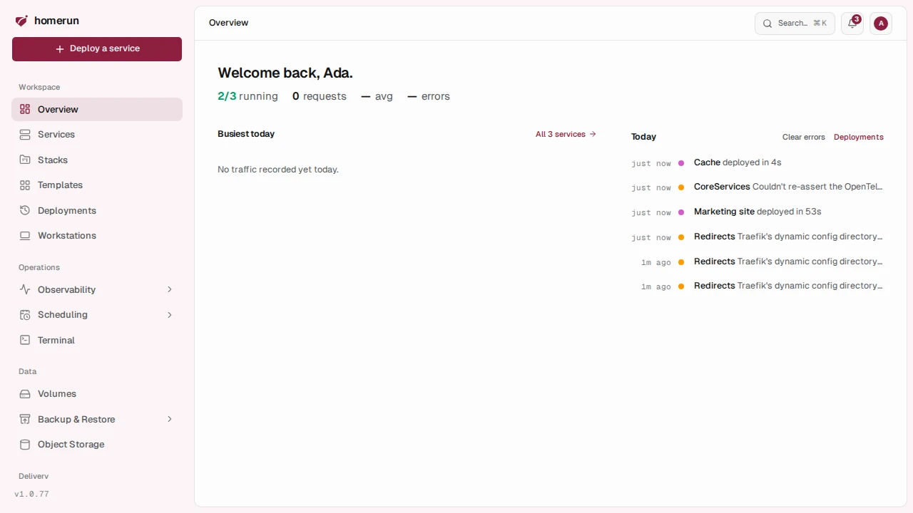
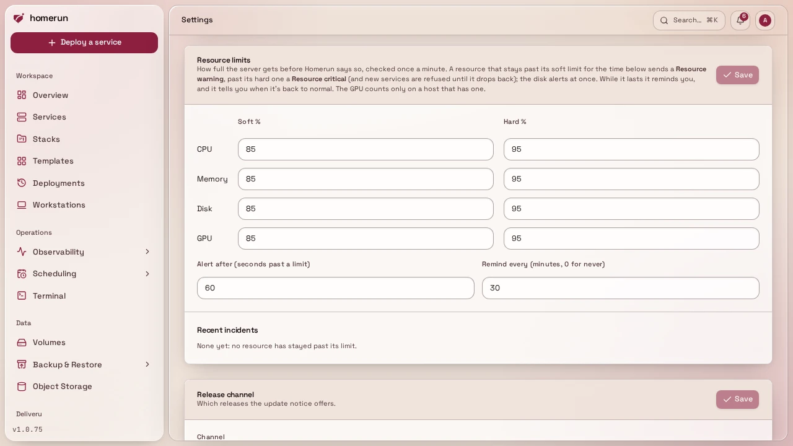
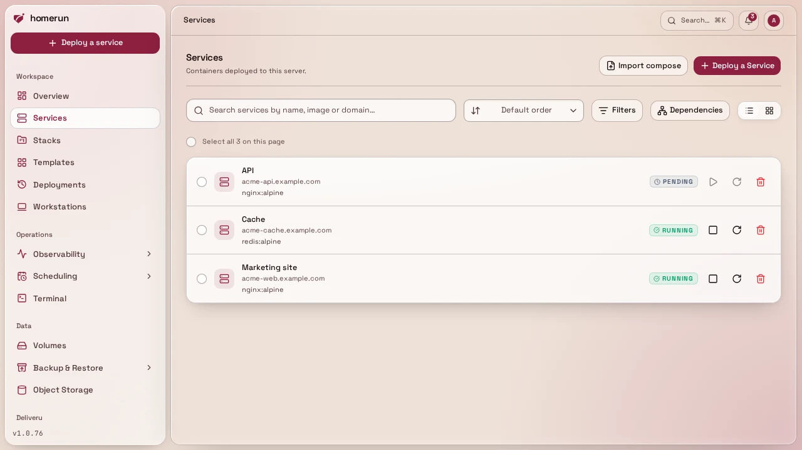
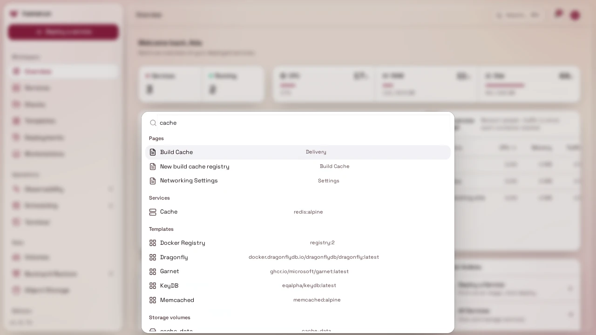

# The dashboard

`/` (Overview) is the landing page after sign-in, kept short on purpose:

- **Today's numbers** under the greeting: how many services are running out of
  how many, and today's requests, average response time and error rate, each
  with how it moved against yesterday.
- **Needs you**, only when something does: a red banner when the server is past
  a hard resource limit, a card per failing uptime probe, and the services with
  an [update](deploy-source-and-builds.md#version-pinning-and-update-checks)
  waiting, with how its trial run went. The setup-issues banner (see below) sits
  right above it.
- **Deploy an app**, in [simple mode](ui-modes.md) only: popular templates with
  a **Quick Deploy** button each.
- **Busiest today**, the five services that served the most requests, each with
  its **lane**: the last 24 hours in half-hour blocks, darker the busier, red
  where a quarter or more of the requests failed, and a diamond for each
  deployment (filled for the latest, red for a failed one). **All services**
  opens the list.
- **Today**, a timeline of the latest deployments and warn/error-level log
  lines, newest first, each linking to its service (or to System Logs). An admin
  sees the instance's errors, a developer only the ones that mention one of
  their services. **Clear errors** empties it.

Live host CPU, memory, disk and GPU, and their history, are on
[Monitoring](observability.md#stacks-and-the-whole-instance).

- **Resource limits**: each of CPU, memory, disk and GPU has a soft and a hard
  threshold (Settings → General → Resource limits, 85% and 95% by default),
  checked against the host once a minute. A resource only alerts once it has
  stayed past a limit for a while (**Alert after**, 60 seconds by default, so a
  short spike doesn't page you; the disk alerts at once, it doesn't spike),
  which opens an incident: past the soft limit it sends a **Resource warning**,
  past the hard one (or when it climbs there later) a **Resource critical**,
  shows a red banner here, and refuses new services (from the wizard, a
  template, a compose import or migration, the API, or a pull request preview)
  until usage drops back. While the incident lasts it reminds you (**Remind
  every**, 30 minutes by default, 0 for never), and the first reading back under
  the soft limit sends a **back to normal** for that resource with how long it
  lasted and its peak. The last incidents are listed under the limits in
  Settings, and one still open when Homerun restarts stays open: no second
  alert, and you still get its recovery. If the host's stats can't be read,
  nothing is refused.

## List pages

Every list page (services, stacks, templates, cron jobs, storage, remote hosts,
build cache registries, backup destinations, users) has the same toolbar: a
search box, a sort (newest, oldest, name A–Z or Z–A, recently updated, and most
services on stacks), filters where the list has any, and a pager. All of them
run on the server over everything you can see, and live in the URL.

## Search

The **Search…** button in the header, or `⌘K` / `Ctrl+K` anywhere, opens a
command palette. It jumps to any dashboard page by name, and once you've typed
two characters it also searches the instance's services, stacks, templates, cron
jobs, storage volumes, backup destinations, remote hosts, build cache
registries, git providers, notification channels and status pages, plus users
and authentication providers for an admin.

## Setup diagnostics

Homerun runs a handful of read-only checks on every dashboard load: base domain
and auth secret still at their defaults, no Dashboard URL set, the dashboard's
own hostname actually routed to it by Traefik, the Traefik container reachable,
the [worker](configuration.md#the-app-and-the-worker) reachable and the Docker
socket it fronts answering, Traefik still running with the flags your settings
put on it (the swarm provider, the HTTP cache plugin, the ACME email), Docker
not stuck on a helper container (see
[Docker stuck on a container](faq-and-limitations.md#docker-stuck-on-a-container)),
and SMTP fully configured if you turned it on. The worker and Docker checks are
reported separately on purpose: a worker that's down and a worker that's up but
can't reach Docker are different problems with different fixes. Any that aren't
OK show up as a banner at the top of the dashboard.

The banner links straight into `/settings`, on whichever tab the offending field
lives, and rings the relevant fields so you can see what it's complaining about
rather than hunting for it. Two checks have nothing to deep-link to: the auth
secret is env-only (`AUTH_SECRET`, change it and restart), and the Traefik
checks are about a live container rather than a setting. When Traefik has lost
flags your settings put on it, usually because it was recreated from the compose
file, an admin gets a **Re-apply** button that puts them back (Traefik restarts,
so routes drop for a few seconds). Homerun also re-applies them on its own every
time its worker starts.

There's no separate `/setup` page, the banner plus `/settings` is the whole
flow.
