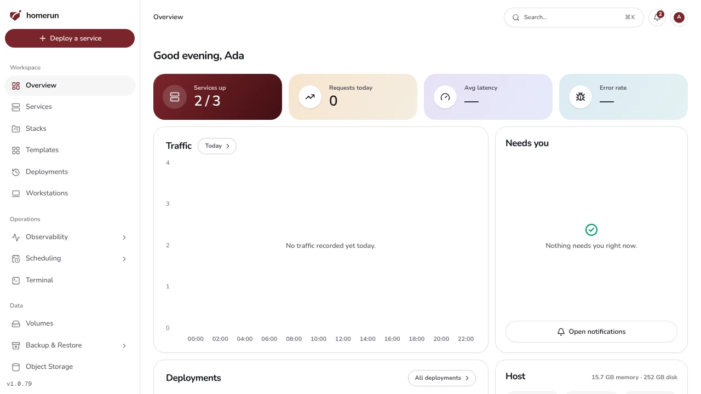
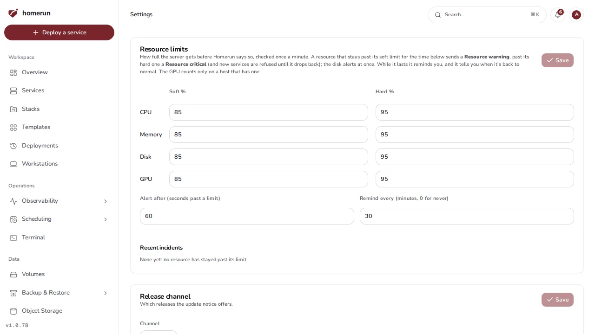
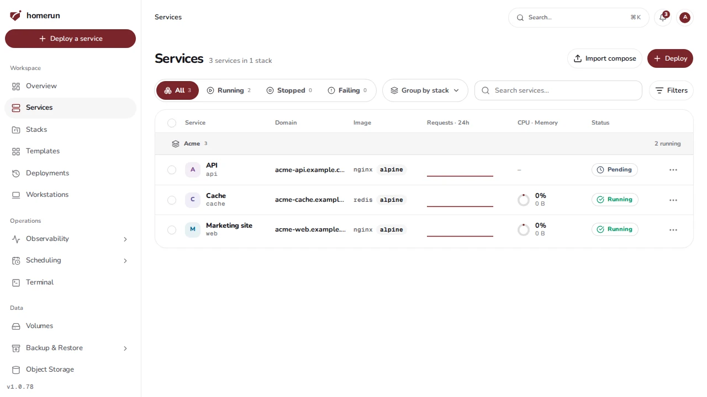
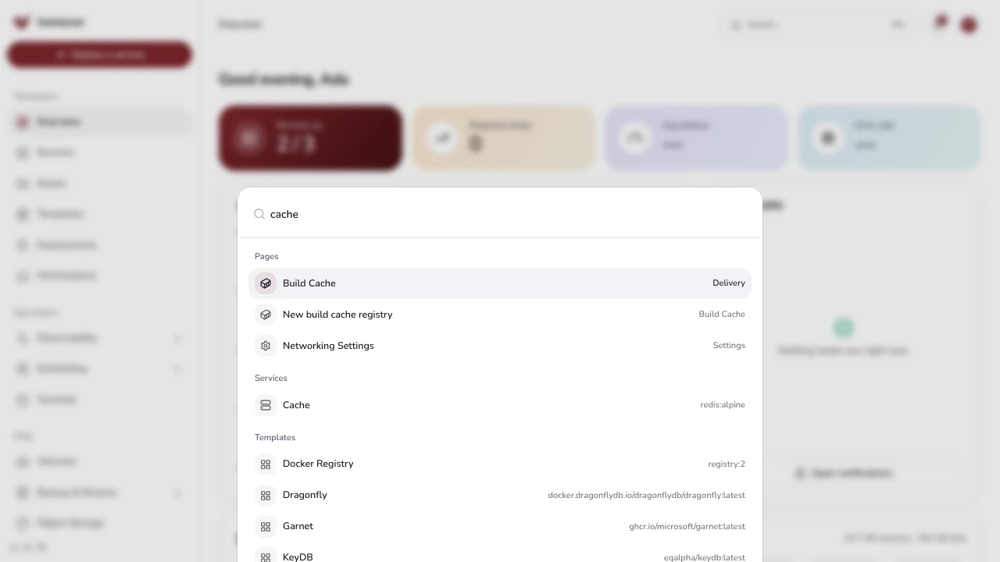

# The dashboard

`/` (Overview) is the landing page after sign-in, kept short on purpose:

- **Today's numbers** under the greeting, as four tiles: how many services are
  running out of how many, and today's requests, average response time and error
  rate, each with how it moved against yesterday.
- **Traffic**, today's requests in two-hour bars, the busiest one highlighted
  with a dashed line at its height. **Today** opens
  [Monitoring](observability.md#stacks-and-the-whole-instance).
- **Needs you**, everything waiting on you, the first four shown (**See all**
  for the rest): [setup issues](#setup-diagnostics) (Traefik's configuration
  re-applied in one click when that's the fix), the server past a hard resource
  limit, failed update trials (retry in one click), services whose uptime probe
  fails, the unresolved [error issues](error-tracking.md) and error-level log
  lines of the last 24 hours, and the services with an
  [update](deploy-source-and-builds.md#version-pinning-and-update-checks)
  waiting (applied in one click). It updates live, and says so when nothing
  needs you.
- **Deployments**, the in-flight and latest deploys, pushed from the server as
  they move: the service, what it shipped (commit or image tag), when it
  started, how long it took and its status. Needs read access to Services.
- **Host**, live CPU, memory, disk and (with an NVIDIA card and `nvidia-smi`)
  GPU for the machine Homerun runs on, refreshed every five seconds. Click CPU,
  memory or disk (here or on Monitoring) for what's using it right now, see
  [What's using it](#whats-using-it).
- **Deploy an app**, in [simple mode](ui-modes.md) only: popular templates with
  a **Quick Deploy** button each.

Their history, over a day to all time, is on
[Monitoring](observability.md#stacks-and-the-whole-instance).

Every chart reads out what's under the pointer: a bar's time range, requests and
error share, a line's value at that moment with its unit, a ring's or meter's
used and total, an uptime beat's time, state and latency. Tap a chart on a
phone, or focus it and use the arrow keys, for the same reading.

- **Resource limits**: each of CPU, memory, disk and GPU has a soft and a hard
  threshold (Settings → General → Resource limits, 85% and 95% by default),
  checked against the host once a minute. A resource only alerts once it has
  stayed past a limit for a while (**Alert after**, 60 seconds by default, so a
  short spike doesn't page you; the disk alerts at once, it doesn't spike),
  which opens an incident: past the soft limit it sends a **Resource warning**,
  past the hard one (or when it climbs there later) a **Resource critical**,
  shows a red banner here, and refuses new services (from the wizard, a
  template, a compose import or migration, the API, or a pull request preview)
  until usage drops back. While the incident lasts it reminds you (**Remind
  every**, 30 minutes by default, 0 for never), and the first reading back under
  the soft limit sends a **back to normal** for that resource with how long it
  lasted and its peak. One still open when Homerun restarts stays open: no
  second alert, and you still get its recovery. If the host's stats can't be
  read, nothing is refused. Every warning, critical and reminder names the
  resource's biggest users at that moment
  (`web 62%, 2.5 cores · slirp4netns 12%`), read the same way as
  [What's using it](#whats-using-it), in the alert itself and in the bell.
- **Remote hosts** connected through a Homerun agent are checked against the
  same limits every minute, with their own incidents and alerts, named after the
  host (`Build box past a hard resource limit`). Their biggest users are the
  agent's busiest processes, containers' included. A remote host never refuses a
  new service, and a raw Docker connection (`tcp://`, `ssh://`) isn't measured:
  there's no agent on it to read the machine with.
- **Monitoring → Incidents** lists every incident, newest first, filterable by
  host, status, resource and limit, and searchable by what was using the
  resource. Above the list, each host's last reading. An incident's page shows
  when it started and ended, how long it lasted, its peak and how many alerts it
  sent; what triggered it; the host's CPU, memory, disk and GPU every minute it
  lasted, from when the limit was first crossed, against the soft and hard
  limits; and, for this server, how the services performed during it (requests a
  minute, average response time, server errors) against as long a stretch right
  before.

## What's using it

Clicking the CPU, memory or disk ring opens a live breakdown, biggest first,
with a Refresh button. It needs read access to Services.

- **CPU** and **memory** sample every running container at once and name each
  one after what it runs for: a service (linking to it), a cron job, a
  workstation (by name for its owner only, "A workstation" for anyone else), a
  build or other helper container, or the container's own name. CPU is each
  container's share of every core together, the same scale as the ring, with the
  cores it keeps busy. Memory leaves out the page cache the kernel can take
  back, the way `docker stats` counts it. What the host uses that no container
  accounts for is broken down into its processes: each one past half a percent
  of the host gets its own row (the same name in the same systemd unit summed,
  `php-fpm ×12`), with the unit it runs in and, for Docker's own processes, what
  it is: rootless Docker's network proxy (`slirp4netns`, `pasta`), for one,
  carries every container's traffic and can be the busiest thing on the host.
  **Rest outside containers** is what's left: the kernel and every smaller
  process. The worker reads the processes from a short-lived Alpine helper in
  the host's PID namespace, since it runs in a container of its own; when that
  fails, the whole remainder is one **Outside containers** row.
- **Disk** lists Docker's volumes one by one, its images (layers they share
  counted once), the build cache no other cache shares, each container's own
  writable layer, and **Everything else** on the disk: the system, logs, files
  outside Docker. When Docker keeps its data on another disk than the one
  measured, its entries don't add up to the ring.

## List pages

Every list page (services, stacks, templates, cron jobs, storage, remote hosts,
build cache registries, backup destinations, users) has the same toolbar: a
search box, a sort (newest, oldest, name A–Z or Z–A, recently updated, and most
services on stacks), filters where the list has any, and a pager. All of them
run on the server over everything you can see, and live in the URL.

## Search

The **Search…** button in the header, or `⌘K` / `Ctrl+K` anywhere, opens a
command palette. It jumps to any dashboard page by name, and once you've typed
two characters it also searches the instance's services, stacks, templates, cron
jobs, storage volumes, backup destinations, remote hosts, build cache
registries, git providers, notification channels and status pages, plus users
and authentication providers for an admin.

## Setup diagnostics

Homerun runs a handful of read-only checks on every dashboard load: base domain
and auth secret still at their defaults, no Dashboard URL set, the dashboard's
own hostname actually routed to it by Traefik, the Traefik container reachable,
the [worker](configuration.md#the-app-and-the-worker) reachable and the Docker
socket it fronts answering, Traefik still running with the flags your settings
put on it (the swarm provider, the HTTP cache plugin, the ACME email), Docker
not stuck on a helper container (see
[Docker stuck on a container](faq-and-limitations.md#docker-stuck-on-a-container)),
and SMTP fully configured if you turned it on. The worker and Docker checks are
reported separately on purpose: a worker that's down and a worker that's up but
can't reach Docker are different problems with different fixes. Any that aren't
OK show up under **Needs you** on the dashboard.

Each one links straight into `/settings`, on whichever tab the offending field
lives, and rings the relevant fields so you can see what it's complaining about
rather than hunting for it. Two checks have nothing to deep-link to: the auth
secret is env-only (`AUTH_SECRET`, change it and restart), and the Traefik
checks are about a live container rather than a setting. When Traefik has lost
flags your settings put on it, usually because it was recreated from the compose
file, an admin gets a **Re-apply** button that puts them back (Traefik restarts,
so routes drop for a few seconds). Homerun also re-applies them on its own every
time its worker starts.

There's no separate `/setup` page, **Needs you** plus `/settings` is the whole
flow.
