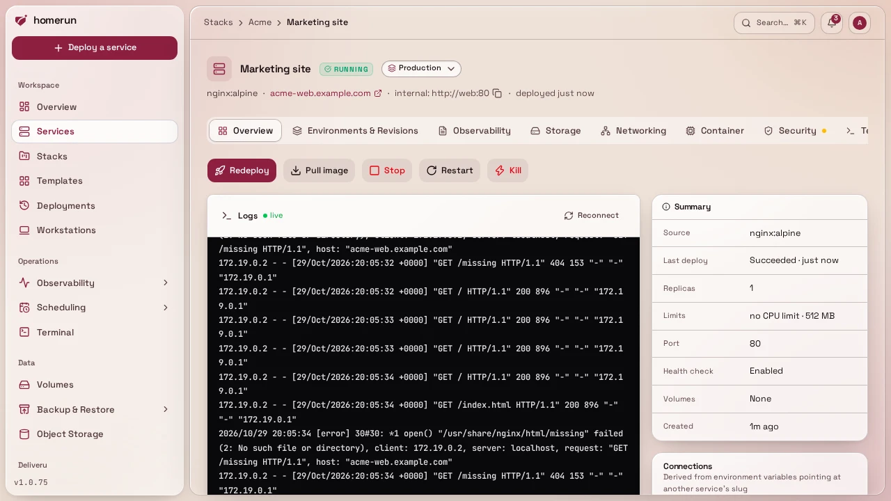

# Deploying

The Overview tab has Deploy (Rebuild for a git service), Start/Stop, Restart
and, depending on the service, **Fresh build** (a git rebuild that ignores every
cached layer), **Pull image** (pulls the configured image and tag without
redeploying, and tells you whether it changed) and **Kill** (SIGKILLs a
standalone container with no grace period; swarm services only get Stop). While
a deploy runs, a live progress panel sits at the top of the tab. The panel shows
six phases, resolving configuration, preparing volumes, fetching image,
provisioning container, routing traffic, ready, ticking off as they complete,
with the raw build/pull output streaming underneath. Progress arrives over
server-sent events (the server pushes each new line and status change; if that
stream can't be held open, the panel falls back to polling), and it resumes
correctly if you reload the page mid-deploy, or if the deploy was started
somewhere else entirely (a template quick-deploy, cron). Below the buttons sit
the service's **Last 24 hours** (requests, average response time, error rate and
deploys, over its lane: half-hour blocks of traffic, darker the busier, red
where a quarter or more of the requests failed, a diamond per deployment), an
**Activity** feed of its latest deploys, failures and rollbacks (each opening
its revision), and its live logs; beside them sit a **Summary** (source, last
deploy, replicas, limits, port, health check, volumes, age), a **Connections**
panel listing the services it references through env vars or depends on through
a [service link](env-vars.md), and the ones that reference or depend on it (same
detection as a stack's dependency graph, see [Stacks](stacks.md)), each with an
**Unlink** button (see [Env vars](env-vars.md#unlinking)). Deployment history,
every attempt with its status, image and full log, is under
[Environments & Revisions → Revisions](revisions-and-rollback.md).

**Redeploys are health-gated.** When the service already has a running
container, the new one starts next to it and the old one keeps serving until the
new one is ready; then the old container is removed. If the new container exits,
restarts, reports unhealthy or isn't ready within 5 minutes, it's removed
instead, its last log lines go into the deploy log, the deploy is marked failed
and the old container carries on untouched. Two cases stop the old container
first: **host networking** (both copies would bind the same ports) and a
**writable volume on a service with no domain** (two copies writing the same
data, a database's data directory for instance). A service with a domain always
starts its new copy first, sharing the volume for the few seconds both run,
since stopping the old one first would 404 every request until the new one is
up. An app that can't share its data directory with a running copy (an embedded
database holding a lock on it, say) fails that way; the deploy then tries once
more with the old copy stopped first, so it goes through with the brief gap
instead of failing. In [swarm mode](swarm-mode.md) the service is updated in
place through swarm's own rolling update, following the same rule, and swarm
rolls back to the previous tasks on its own when a new one fails.

**Readiness: no traffic before the new copy is ready.** Like a Kubernetes
readiness probe, a new container or swarm task gets no traffic from Traefik
until its readiness check passes. Both are built on Docker's healthcheck:
Traefik skips a container whose health isn't `healthy` yet, and swarm keeps a
task out of `running` (so out of Traefik and out of the service's own DNS) until
its healthcheck passes. The deploy log says which check applies:

- none at all when healthchecks are [turned off](services.md#health) for the
  service;
- the service's **healthcheck command**, when set;
- otherwise the image's own `HEALTHCHECK`;
- otherwise a check Homerun adds itself, which passes once something in the
  container listens on the container port (on any address but loopback). It only
  needs `/bin/sh` in the image, not curl, wget or nc, and after a crash or a
  restart it holds traffic back again until the port is listening.

A healthcheck is readiness and liveness at once: after the first pass it keeps
running every 30 seconds, and three failures in a row mark the container
unhealthy, which takes it out of Traefik, fails the revision's health watch, and
in swarm mode gets the task replaced. Homerun's own listening check is ignored
by the uptime probe, which keeps probing the port over HTTP or TCP.

There's no readiness gate, and the new copy gets traffic as soon as it runs,
when the port is UDP only or the image has neither a healthcheck nor `/bin/sh`
(`scratch` and distroless images). Add a `HEALTHCHECK` to such an image for a
real gate. A standalone container then shares traffic with the old one from the
moment it starts, and counts as ready after running 5 seconds. A swarm task is
worse off: swarm stops the old task as soon as the new one runs, so requests
fail until the new one listens. Services that aren't published through Traefik
(not DNS-resolvable, host networking) have no traffic to hold back. Other
services reaching this one by its slug on the Docker network aren't gated in
standalone mode: Docker's DNS resolves the name to the new container as soon as
it starts. In swarm mode the service name only resolves to tasks that passed
their healthcheck.

**Route check: a deploy only succeeds once its address answers.** Once the new
copy is running, the routing traffic phase asks every hostname the service is
published at for its page, through Traefik on this server, and through its
public URL too when [DNS automation](dns-automation.md) or Pangolin points that
hostname here. Traefik gets a moment to pick up the new route: each address is
retried for up to 30 seconds before it's judged. The deploy fails when the
answer is Traefik's own rather than the app's: no route for the hostname
(Traefik's 404, or the not-found [error page](error-pages.md)), or Traefik
unable to reach the container (502 or 504), or, publicly, an edge that answers
with its own default certificate for another name, or Cloudflare unable to reach
this server. Such a deploy keeps the new copy running, so you can read its logs,
and its Overview still shows it running; only the deployment is marked failed.
Whatever the app itself answers, a 401, a 404 or a 500, counts as an answer: a
502 or 504 is checked against the container directly, and one the app returns
itself passes. The one look-alike is a bare `404 page not found`, Traefik's
exact text: without published error pages it's taken for Traefik's. A
certificate still being issued, a public URL that doesn't resolve yet (DNS still
propagating), a service that doesn't speak HTTP, or a Traefik this server can't
reach only add a warning to the deploy log. Database images and UDP-only ports
aren't checked.

**Requests racing a removed copy are retried.** Every published service's router
carries a retry middleware: a request that reaches a container or swarm task
that just went away, before Traefik has dropped it, is retried on another copy,
up to four times with a short backoff. Traefik only retries when nothing of the
request reached the app, so a form post is never sent twice. Traefik reads swarm
every 2 seconds rather than reacting to events, which is how long an old task
can stay in its list; the retry covers that window.

Clicking Deploy **queues** the deploy rather than running it inside the request
(see [The job queue](scheduling.md#the-job-queue)), so the button comes back
immediately and the progress panel narrates the rest. Same for "Create and
Deploy" at the end of the new-service wizard: it creates the service, queues the
deploy, and drops you straight on the service page watching it come up.
