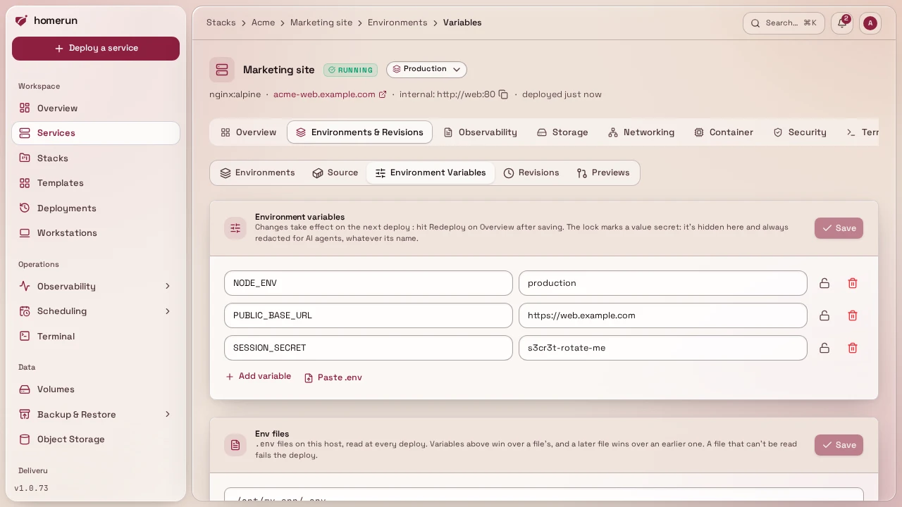
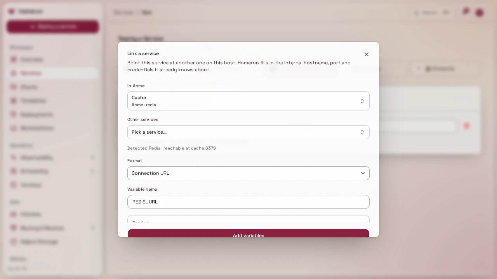
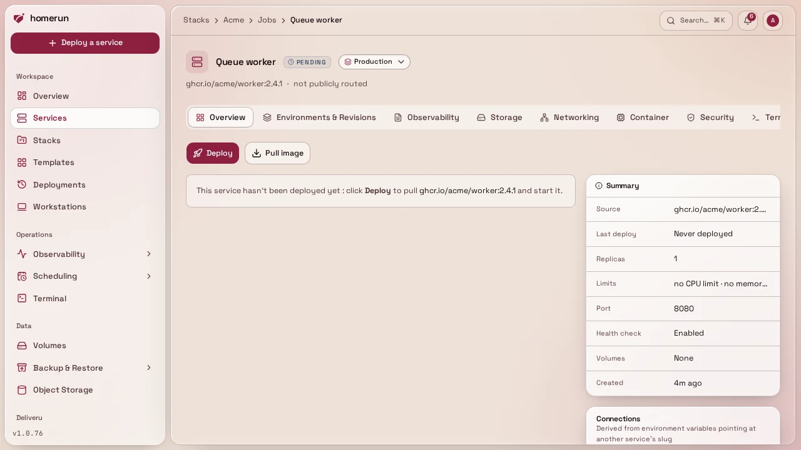
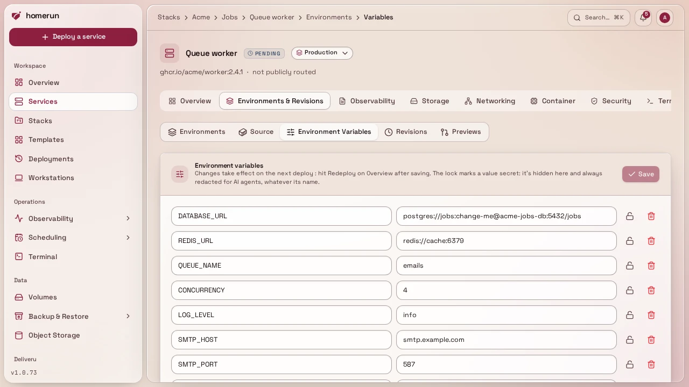
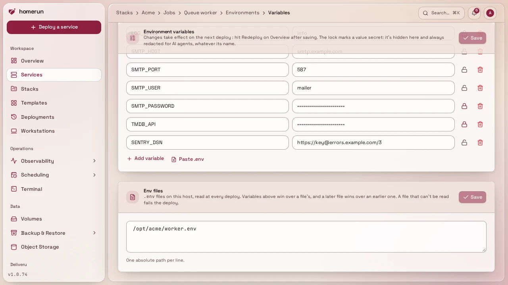

# Environment variables

Plain key/value rows under a service's **Environments & Revisions → Environment
Variables**, stored as-is (not encrypted, don't put a raw plaintext secret you'd
mind leaking in the DB dump into an env var if you can avoid it; registry
passwords and similar have their own encrypted fields instead).

**Link a service** in the new-service wizard's Environment step fills those rows
in for you from a service you already run, in any stack or none: pick it, and
Homerun recognises what it is from its image (PostgreSQL, MySQL/MariaDB,
MongoDB, Redis-compatibles like Valkey, Dragonfly, KeyDB and Garnet, RabbitMQ,
or a plain HTTP service) and reads the credentials off its own env vars. A Redis
password set with `--requirepass` in the service's command counts too. The
**Link to** dialog on a service's context menu does the same for a service that
already exists, and it always writes the database or cache's own vars into the
other service, whichever of the two you right-clicked. The picker lists the
services in the same stack first, and every entry says which stack it's in. You
then choose the shape you want:

- **Connection URL**, e.g. `POSTGRES_URL=postgres://app:secret@db:5432/app`. For
  PostgreSQL there's also a `postgresql://` variant, since drivers disagree on
  which scheme they accept.
- **JDBC URL** (relational engines only), e.g.
  `jdbc:postgresql://db:5432/app?user=app&password=secret`.
- **One variable per value**, e.g. `DB_HOST`, `DB_PORT`, `DB_USER`,
  `DB_PASSWORD`, `DB_DB`.
- **Dependency only (no env vars)**, the **Link to** dialog only: writes nothing
  into the environment, just records the link.

Every link from the **Link to** dialog, whatever its shape, also records that
the consumer depends on the other service. That's what sets start order:
starting a service starts whatever it depends on first (if it's deployed and not
already running), a bulk start or restart on the services list runs dependencies
before the services that need them and a bulk stop runs the other way round, and
deploying a stack deploys dependencies first. A link that would make two
services depend on each other, directly or through others, is refused when it's
dependency only; with env vars the variables are still written, just without the
recorded dependency.

Links made before Homerun recorded dependencies only had their env vars, so on
upgrade the dashboard records them once at startup: for each service that has no
recorded dependency yet, every service one of its env values points at, when the
two share a stack or the value is a URL or `host:port` (a bare
`REDIS_HOST=redis` across stacks doesn't count), becomes a recorded dependency,
app before database whichever side holds the variable. One that would make a
loop is skipped and logged. The API, CLI and MCP server can also read and
replace a service's recorded dependencies directly, see
[API & CLI](api-and-cli.md).

The suggested variable name (or prefix) is a default, not a rule, rename it to
whatever your app expects before adding it. The host in every generated value is
the linked service's slug, which is how services already reach each other on the
shared network, so this works across stacks and needs no extra networking. The
same full URL, password included, is what a service's header and its Networking
tab show as its internal address (masked on screen, copied in full).

## Unlinking

A service's Overview tab has an **Unlink** button on each row of its
**Connections** panel (see [Deploying](deploying.md)), and a stack page's
right-click menu offers the same thing as **Unlink from**. Both list exactly
which env vars will be removed before you confirm, then delete those rows from
the service that holds them, same as deleting them by hand, and drop the
recorded dependency. The env change takes effect on that service's next deploy;
a dependency-only link has no variables and is gone at once.

## Marking a variable secret

The lock icon next to a row in the Environment Variables section (a service's,
or a [cron job's](scheduling.md)) marks that variable secret, independent of its
name: useful for something that doesn't look secret, like `TMDB_API`. A variable
a template fills with a generated password starts out marked.

A secret's stored value is never put back in the page: its field is empty and
shows the same fixed row of dots whatever the value's length. Leave it untouched
and saving keeps the stored value; type in it and the new value replaces it.
Unlocking a variable you haven't retyped shows its stored value again.

A secret is always redacted for an AI agent through the [MCP server](mcp.md),
whatever it's called. The REST API, the CLI and Terraform read and set the marks
as `secretEnvKeys` (`secret_env_keys` in Terraform), next to `envVars`.

## Build-time variables

A service built from a git repo gets a hammer icon next to each row. It marks
that variable build-time: besides being set in the running container, it's
handed to the build on every deploy:

- **Dockerfile**: as a build argument (`--build-arg NAME=value`). The Dockerfile
  only sees it where it declares it, `ARG NAME` (then `ENV NAME=$NAME` if a
  `RUN` step's tools read it from the environment, like `next build` reading
  `NEXT_PUBLIC_*`).
- **Docker Bake**: as a build argument of the built target
  (`--set <target>.args.NAME`), declared with `ARG` in its Dockerfile the same
  way.
- **Nixpacks** and **buildpacks**: as build environment (`--env NAME=value`).
- **Railpack**: as build environment, mounted into its build steps as BuildKit
  secrets.

A build argument ends up in the image's history (`docker history`), so keep real
secrets out of a Dockerfile's `ARG`s: use them for public config baked into a
frontend bundle (`NEXT_PUBLIC_API_URL`, `VITE_*`), a version, a feature switch.
A build-time variable's name must be a plain identifier (letters, digits and
underscores, not starting with a digit), and only the service's own variables
count, not its [env files](#env-files). Previews and environments start with the
parent's marks. The REST API, the CLI and Terraform read and set them as
`buildEnvKeys` (`build_env_keys` in Terraform), next to `envVars`.

## Env files

Under the variables, **Env files** lists `.env` files on this host, one absolute
path per line, read at every deploy through a short-lived helper container (so
they work even though Homerun itself runs in a container). A later file wins
over an earlier one, and the service's own variables win over both. A file that
can't be read fails the deploy, the same as a missing `env_file` fails
`docker compose up`. Only an account with write access to System can change the
list, since the files are read off the host.

