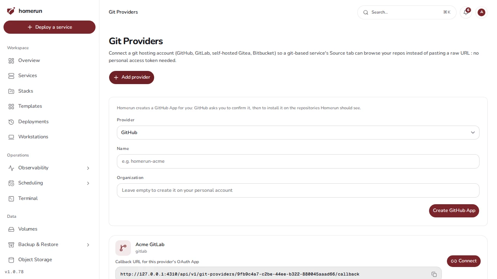

# Connecting a git provider

`Git Providers` in the sidebar is what turns "paste a clone URL" into "browse my
repos", and it's how a private repo works without putting a token in the URL. It
takes two steps, done by different people:

1. **Someone with write access to Git providers registers the provider**, once,
   from **New provider**, which opens its own page. For **GitHub**, give the app
   a name (and an organization, or leave it empty for your personal account) and
   click **Create GitHub App**: GitHub asks you to confirm the app, then to
   install it on the repositories Homerun should see. Nothing to copy by hand.
   The app only asks for what Homerun uses: read access to code, commit statuses
   and checks, and write access to repository webhooks, pull requests and
   deployments (the last two for
   [pull request previews](pull-request-previews.md)). To give it more
   repositories later, change the installation on GitHub. **An app created
   before previews reported to GitHub** lacks the pull request and deployment
   permissions, and GitHub answers "Resource not accessible by integration": in
   the app's settings on GitHub, under **Permissions**, give it **Read and
   write** on **Pull requests** and **Deployments**, save, then accept the new
   permissions on its installation (**Settings → Applications → Installed GitHub
   Apps → Configure**). Reconnecting isn't needed. A repo that already has
   Homerun's webhook (from a deleted app or an earlier connection) keeps it:
   Homerun takes it over and updates its secret and events instead of adding a
   second one, which GitHub and Gitea refuse. For GitLab, self-hosted Gitea
   (which also wants its base URL) or Bitbucket, register an OAuth application
   on that provider's own site and paste the client id and secret in. Adding it
   opens the provider's page, which prints the exact callback URL to register on
   the provider's side.
2. **Each person connects their own account** from the same page, one click
   through the provider's consent screen. Connections are per-account: your
   token is yours, and another user connecting to the same provider gets their
   own.

Once connected, a service's **Environments & Revisions → Source** section (and
the new-service wizard) picks the repository and branch from that account
instead of asking for a clone URL, and checks the repo for a `Dockerfile`.
Picking one also turns on [Deploy on push](deploy-on-push.md), with the webhook
added for you. **Use a clone URL instead** is still there for any other repo.
Tokens are stored encrypted, refreshed automatically when the provider issues
short-lived ones, and disconnecting removes them.

## A provider's own page

Click a provider to open its page. **Connection** shows which account you're
connected as and since when, with **Connect**, **Reconnect** and **Disconnect**;
GitLab, Gitea and Bitbucket providers also show the callback URL there.
**Reconnect** (also on the list) runs the provider's consent screen again and
replaces your token: use it when repos go missing, a webhook can't be added, or
to switch to another account on that provider. **Settings** (write access only)
renames the provider, changes a GitLab or Gitea base URL and an OAuth app's
client id and secret (leave the secret empty to keep it), and holds the danger
zone: **Disable** keeps everyone's connections but stops anyone connecting or
reconnecting, **Delete** removes the provider and every connection to it. A
GitHub App renamed here keeps its own name on GitHub, and deleting the provider
doesn't delete the app there.

Cloning itself is provider-agnostic, so any public HTTPS git URL works with no
provider connected at all.

## Renamed accounts, organizations and repositories

Rename your account or organization on the provider, or rename or transfer a
repository, and Homerun follows it within the hour. Every hour it reads each
repository picked from a connected account (services building from it, their
environments and previews, and [watched repositories](pipelines.md)) by the
provider's own id for it, which never changes, and writes the new `owner/name`
and clone URL wherever the old one was. The service's activity shows the change.
A repository Homerun hasn't learned the id of yet (one picked before this
existed, until its first check) is read by its old path, which most providers
redirect for a while, or else matched by name among the repositories your
account can see, when exactly one has that name. The account name shown on a
connection is refreshed the same way. Webhooks keep working through a rename,
since providers tie them to the repository, not to its path.

Following the id also means a repository whose old path gets taken over (someone
registers your old username and creates a repository with the same name) isn't
built in its place. A repository entered as a clone URL, with no provider
picked, isn't followed: edit its URL by hand. Neither is a workstation's
repository.

**Connections made before deploy-on-push existed** only allowed reading repos on
GitLab, Gitea and Bitbucket. The Source section offers to reconnect them once
Homerun is refused; until then it shows the webhook to add by hand. **Gitea
keeps the old read-only permissions across a reconnect**: it reuses the
authorization it already has for Homerun without asking again. Revoke Homerun
under Gitea's **Settings → Applications → Authorized OAuth2 Applications**
first, then reconnect, and Gitea asks for the new permissions.
