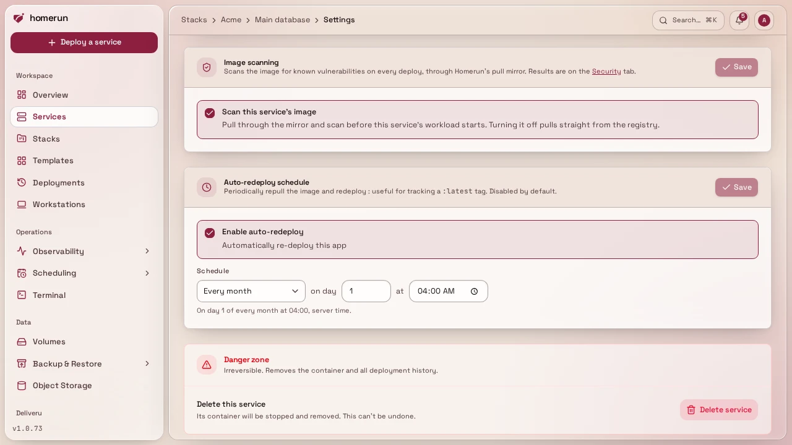
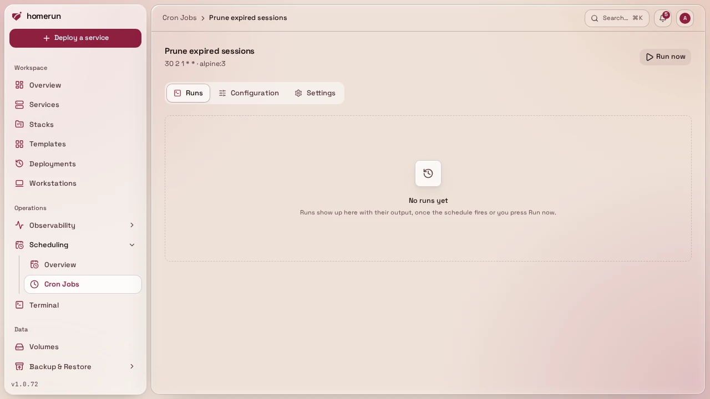
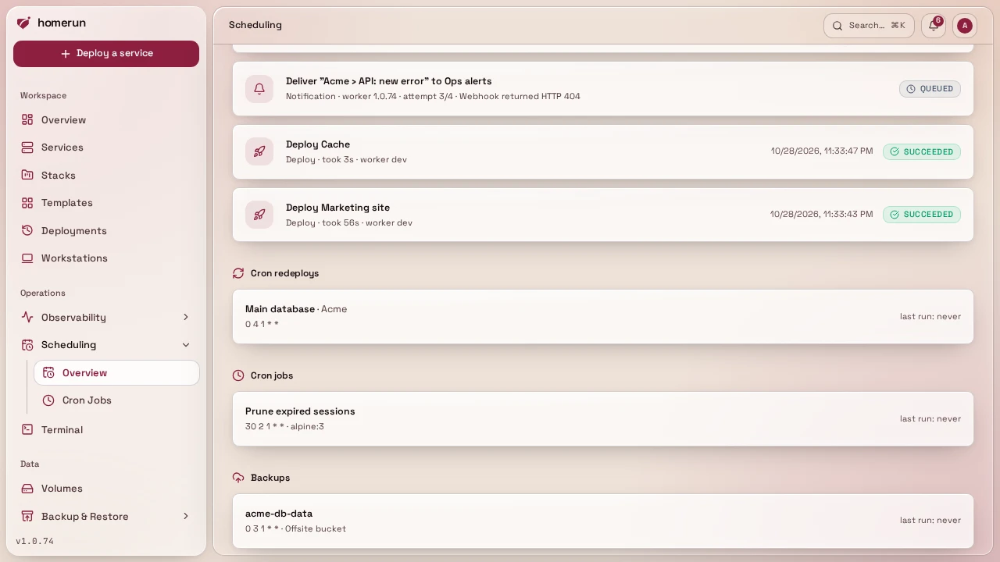
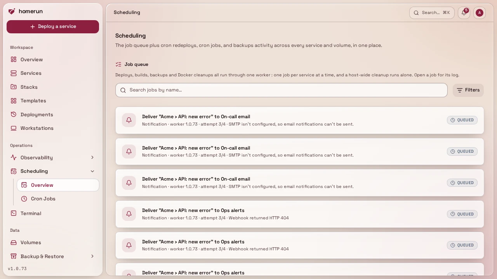

# Scheduling and the job queue

Advanced mode: [simple mode](ui-modes.md) hides the Scheduling sidebar entry.
Everything here keeps working either way, and a hidden page still opens from a
link.

Everything that runs on a timer or in the background: scheduled redeploys, cron
jobs, the Scheduling page that lists them, and the job queue behind all of it.

## Scheduled redeploy

Off by default, per service, the Settings tab's `cronEnabled` checkbox + a
standard 5-field cron schedule. Useful for an image tracking `:latest`, or a
git-mode service you want rebuilt on a schedule rather than manually. A due
schedule queues a deploy like any other trigger, so a redeploy that's still
waiting its turn is never queued twice.

## Cron jobs

**Cron Jobs** in the sidebar is the other half of scheduling: a task on a
schedule, or run on demand, that isn't tied to a service. Each job runs one of
three ways:

- **Container**: an image (plus optional tag, command override, env vars, and
  private-registry credentials) run as a throwaway container. Homerun pulls the
  image if it's missing, runs it to completion, keeps its stdout/stderr, and
  removes the container. Renovate is the typical one: `renovate/renovate` with
  `RENOVATE_TOKEN` and friends as env vars, and its config as a config file.
- **Source code**: paste a script and pick a runtime (Bun, Node.js, Deno, Python
  or `sh`), and it runs on the official Alpine image for that runtime, written
  to `/homerun/main.<ext>`. Install dependencies from the script itself if it
  needs any (Bun and Deno fetch npm imports on their own).
- **Host command**: a shell command run through `sh -c` on the Docker host
  itself, not inside Homerun's container: a throwaway privileged `alpine:3`
  helper sharing the host's PID namespace uses `nsenter` to step into the host's
  own namespaces, so the command sees the host's filesystem, network and
  processes as root. Only the job's own env vars are set. **Needs write access
  to System** (admins only, unless a custom role has it). With rootless Docker
  "the host" is the rootless daemon's own namespace, and with Docker Desktop or
  OrbStack it's their Linux VM, not your Mac.

Container and source code jobs also take **config files**: any number of text
files, each an absolute path and its content, written into the container before
its process starts, so an image that reads a config file gets one without
building your own image. Homerun wraps the image's entrypoint in a `/bin/sh`
script that writes the files and then runs the image's own entrypoint and
command, so the image needs `/bin/sh`, and the path must be writable by the user
the image runs as: `/tmp` always is, a root-owned directory isn't for an image
that runs as non-root, such as Renovate. Up to 20 files of 64 kB each, text
only. A file can carry a **mode** (octal, like `600` for one holding a token),
set right after it's written.

They also take what the container itself runs with:

- **User**: `uid`, `uid:gid`, `name` or `name:group`, blank for the image's own.
  The container writes its config files as that user.
- **Volumes**: storage volumes (from **Volumes**) mounted at a container path,
  optionally read-only, for a cache or data that outlives a run, such as the
  Renovate cache. A fresh named volume takes the owner of the image's own
  directory at that path when the image has one; at a path the image doesn't
  have, it's root-owned and a non-root user can't write to it. A volume lives on
  this server, so a job running on another build server can't mount one. **New
  volume** under the list creates one without leaving the form (a Docker volume
  or a host path, like **Volumes → New volume**, and it needs write access to
  Volumes & backups) and adds it to the job's volumes, ready for its container
  path.
- **Docker socket**: mounts the Docker socket at `/var/run/docker.sock` and adds
  the socket's group to the container, so a non-root user can use it. That's
  root on the host, so it **needs write access to System**, both to set it and
  to manage or run a job that has it.

A job's page has three tabs: **Runs**, **Configuration** (what runs and how:
everything above) and **Settings** (name, schedule, timeout, the schedule
toggle, and deleting the job). **Runs** leads with the latest run: press **Run
now** in the header and it shows the run queued, then running with its output
filling in every couple of seconds, then its outcome and exit code. Below it,
the run history lists each run with its start, trigger (the schedule or a manual
run), exit code and duration. Click one for the run's own page: its status,
trigger, start and finish, duration and exit code at the top, then a **Logs**
tab with the full output (still following a run in progress) and a **Traces**
tab with the worker's trace of the run (picking it up, running the container
with its exit code, and recording the result), with a link to the full trace
under **Monitoring → Traces**. A trace lands a few seconds after the run
finishes and is kept for the trace retention set under **Monitoring →
Settings**; runs from before this version have no trigger or trace recorded.

Give it a 5-field cron schedule, a timeout (default 900s, the job is killed past
it), and turn the schedule on or off without deleting the job. With the schedule
off it's a one-off task: it only runs when you press **Run now**, or when
something calls `POST /api/v1/cron-jobs/{cronJobId}/run` with an API key (a CI
step, another service), which queues a run and answers `202` with the queue
job's id to poll on `GET /api/v1/jobs/{jobId}`. Runs go through the same
[job queue](#the-job-queue) as deploys and backups, so **Run now** returns
immediately and one job never runs twice concurrently. Each run's exit code,
captured output (its last 64k characters) and trace are kept on the job's page,
and enabled jobs also show up on the Scheduling page next to cron redeploys and
backups.

## The Scheduling page

`/scheduling` is one instance-wide view of everything that runs on a timer or in
the background:

- **Cron redeploys**, every service with
  [scheduled redeploy](#scheduled-redeploy) turned on, with its schedule and
  when it last fired.
- **Cron jobs**, every enabled [cron job](#cron-jobs).
- **Backups**, every volume with a [backup schedule](backups.md#backups), and
  which backup destination it writes to.
- **The job queue**, what's running right now, what's waiting, and how the last
  handful of jobs finished, refreshing itself every few seconds while anything
  is active.

It's a read-only overview: edit a schedule on the thing that owns it (the
service's Settings tab, the cron job's own page, the volume's page).

## The job queue

Deploys, git builds, image scans, volume backups and Docker cleanups all run
through one background worker instead of inside the request that triggered them.
That buys four things worth knowing about as an operator:

- **Repeats collapse.** Queueing a deploy for a service that already has one
  waiting doesn't queue a second, it joins the one that's already there. Push
  five times in a minute to a git-based service on a redeploy schedule and you
  get one build, not five.
- **One deploy per service at a time.** Different services still deploy in
  parallel (up to three jobs at once); the same service never deploys twice
  concurrently.
- **Linked services keep their order.** Deploying a template that links a
  database or cache queues the companions first and the primary service behind
  them, and if a companion fails, the primary is cancelled rather than started
  against a missing dependency.
- **A Docker cleanup runs alone.** A host-wide prune waits for anything already
  running to finish and holds new work back while it runs, so it can't delete
  images or build cache out from under a deploy in flight. It does take
  precedence over deploys that are merely queued.

The **Scheduling** page has a Job queue panel showing what's running, what's
waiting, and how recent jobs finished. Each job shows an icon for its type, how
long it took and which worker version ran it. Search jobs by name, or filter
them by type in **Filters** (with how many of each there are). Click a job to
open its own page: when it was queued, started and finished, its attempt and
stage, its error, and its log, which keeps filling in while the job runs. Work
that was still running when the app was restarted is put back on the queue at
next boot.

A failed deploy is not retried automatically, you'll see it fail and decide;
backups get one retry.
